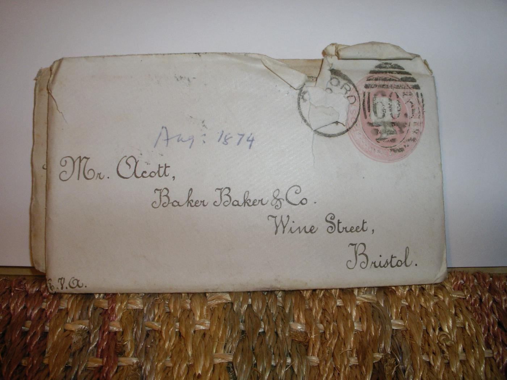
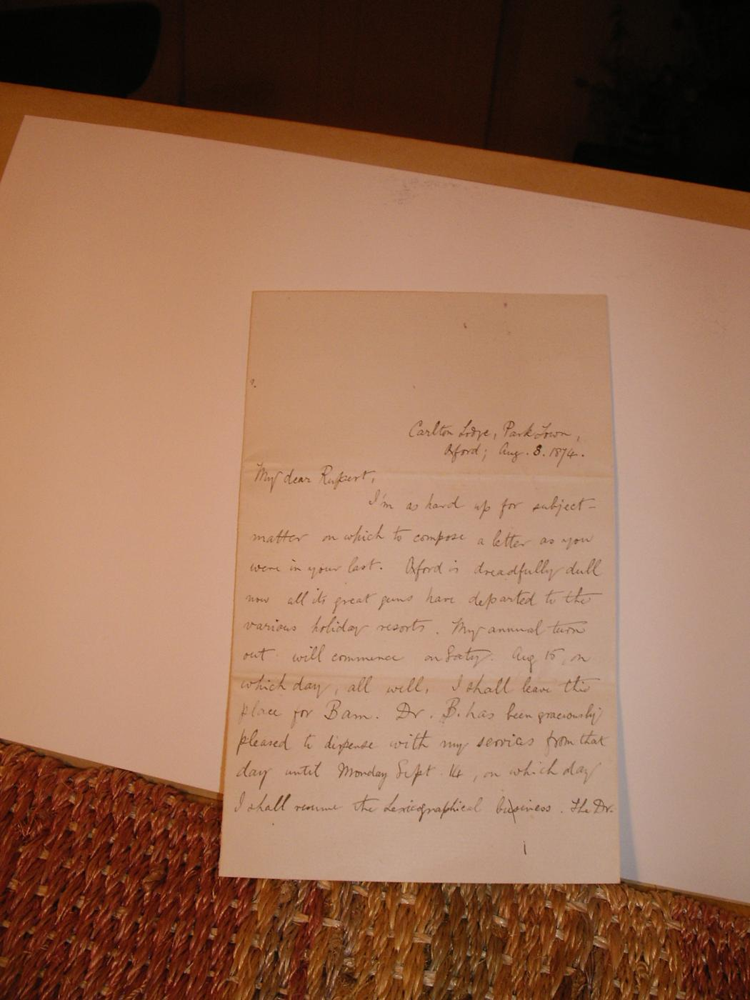
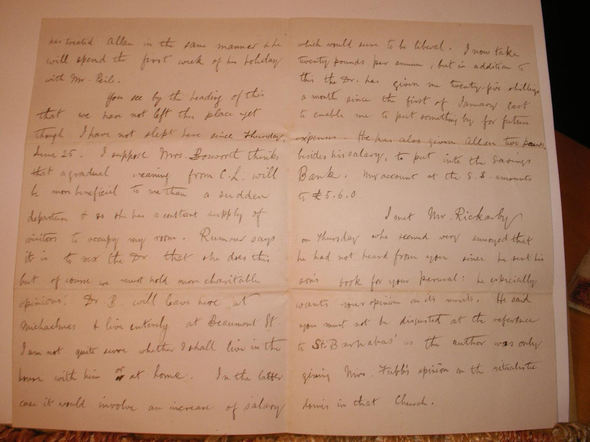
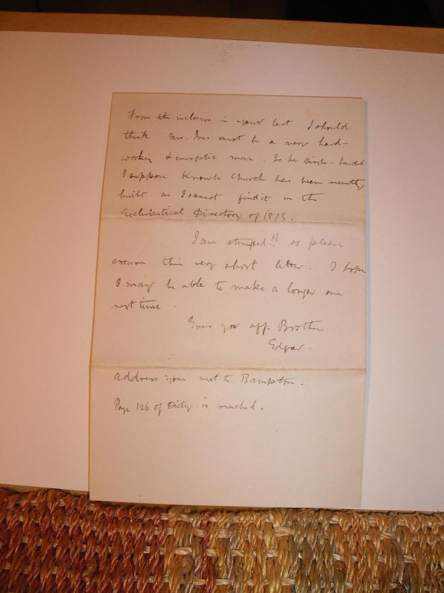
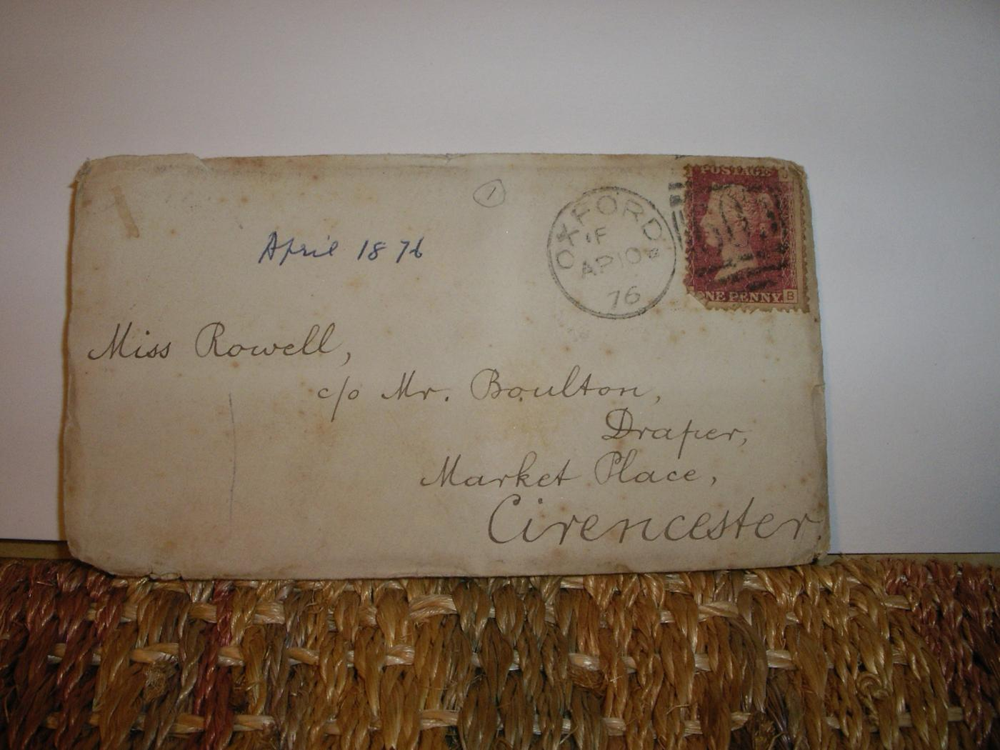
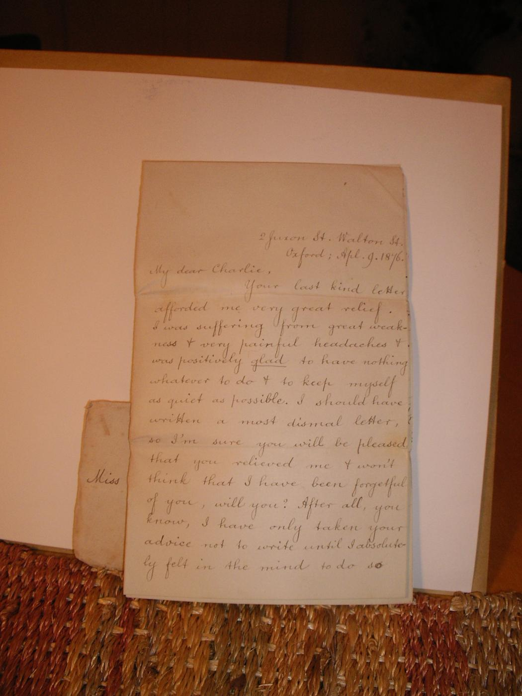
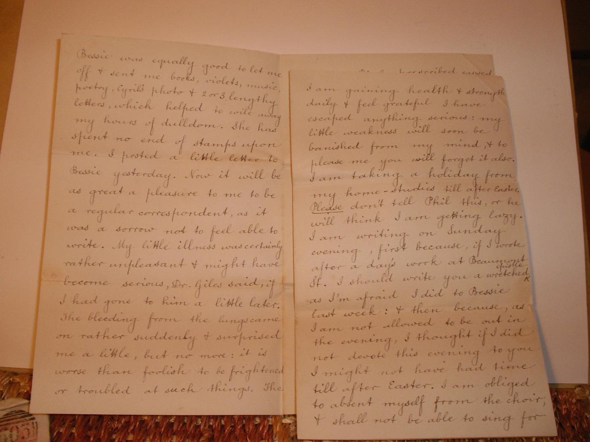
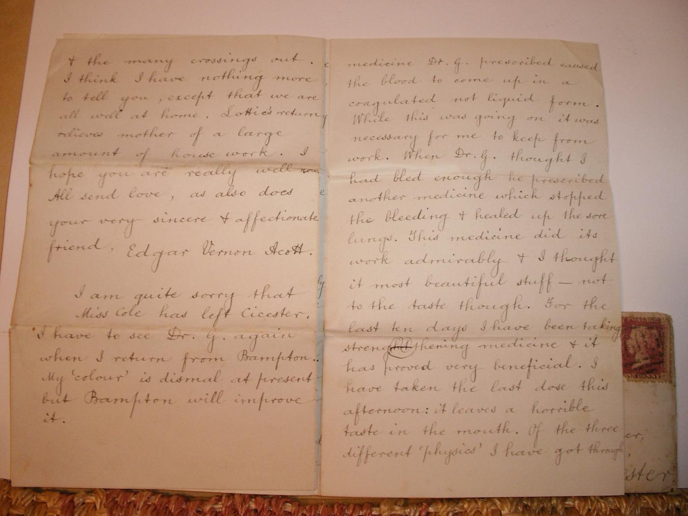
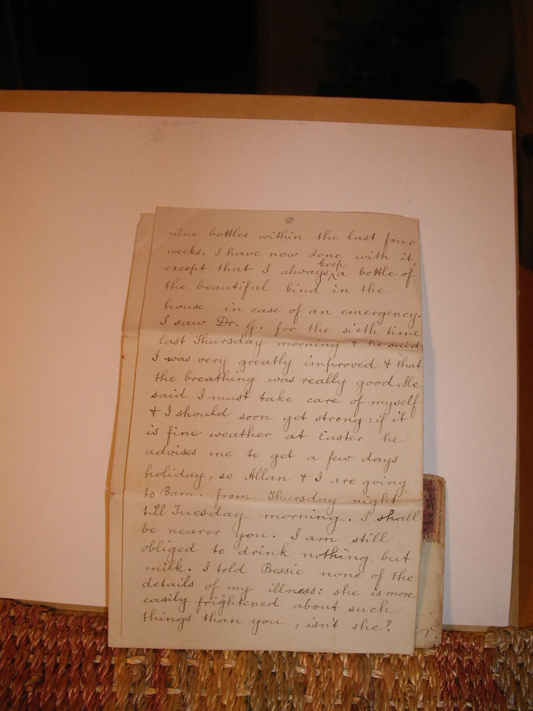
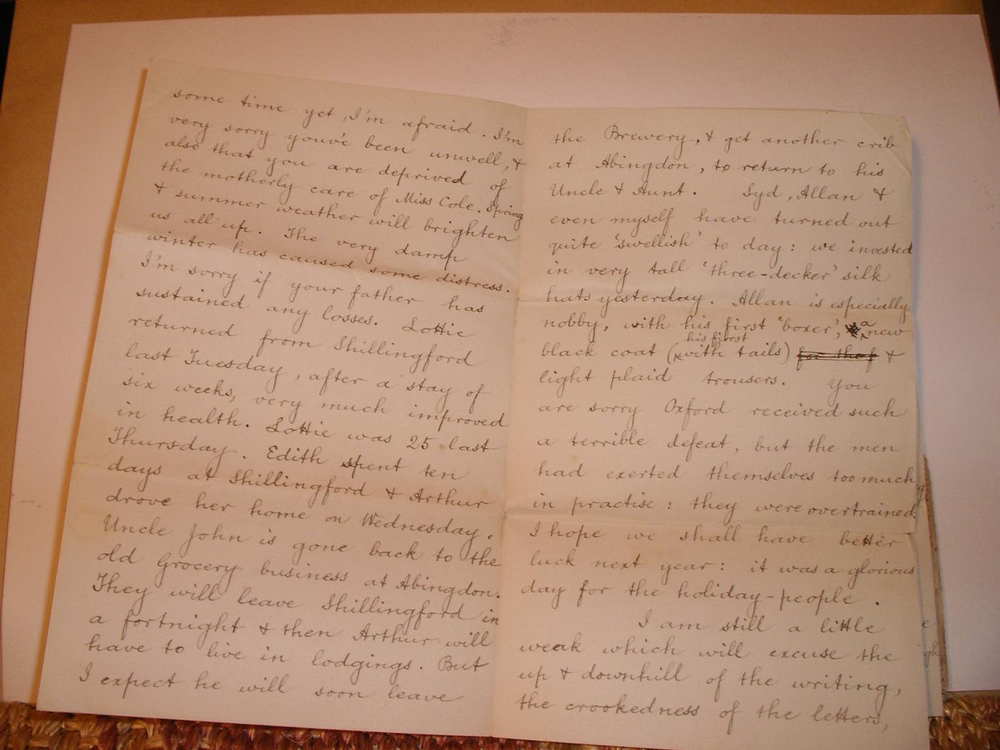

*← [The Acott Family](Acott-Family/) · [Gladys Silver](Gladys-Silver/) · [Silver Family Archive](./)*

**Edgar Vernon Acott** (1856–1876) was a younger brother of Rupert Philip Acott, Gladys Silver's father (see [The Acott Family](Acott-Family/)). He was the amanuensis, or secretary, of **Dr Joseph Bosworth**, the Oxford professor of Anglo-Saxon who was compiling his *Anglo-Saxon Dictionary*, and his younger brother **Allan** worked for Bosworth too. Two of his letters survive among the photographs David Silver saved from his parents' house.

- **8 August 1874**, to his brother **Rupert** at Baker, Baker & Co., Wine Street, Bristol. Edgar is eighteen and in good spirits, and the dictionary has reached page 126.
- **9 April 1876**, to **Charlotte Rowell** ("Charlie"), Rupert's future wife, care of Mr Boulton, draper, Market Place, Cirencester. Edgar is recovering from bleeding from the lungs and is sure he has "escaped anything serious". He died later that year, aged about twenty. Dr Bosworth died on 27 May 1876.

*Transcribed from photographs of the letters, November 2026. Edgar's spelling and punctuation are kept. Uncertain readings are marked (?).*

## Letter to Rupert, 8 August 1874

> Carlton Lodge, Park Town,
> Oxford; Aug. 8. 1874.
>
> My dear Rupert,
> I'm as hard up for subject-matter on which to compose a letter as you were in your last. Oxford is dreadfully dull now all its great guns have departed to the various holiday resorts. My annual turn out will commence on Saty. Aug 15, on which day, all well, I shall leave this place for Bam. Dr. B. has been graciously pleased to dispense with my services from that day until Monday Sept 14, on which day I shall resume the lexicographical business. [He] has treated Allan in the same manner & he will spend the first week of his holiday with Mr. Peile.
>
> You see by the heading of this that we have not left this place yet though I have not slept here since Thursday, June 25. I suppose Mrs. Bosworth thinks that a gradual weaning from C.L. will be more beneficial to me than a sudden departure & so she has a constant supply of visitors to occupy my room. Rumour says it is to vex the Dr. that she does this but of course we must hold more charitable opinions! Dr. B. will leave here at Michaelmas & live entirely at Beaumont St. I am not quite sure whether I shall live in the house with him or at home. In the latter case it would involve an increase of salary which would sure to be liberal. I now take twenty pounds per annum, but in addition to this the Dr. has given me twenty-five shillings a month since the first of January last to enable me to put something by for future expenses. He has also given Allan two pounds, besides his salary, to put into the Savings Bank. My account at the S.B. amounts to £5.6.0.
>
> I met Mr. Rickarby on Thursday who seemed very annoyed that he had not heard from you since he sent his son's book for your perusal: he especially wants your opinion on its merits. He said you must not be disgusted at the reference to St. Barnabas' as the author was only giving Mrs. Tubb's(?) opinion on the ritualistic doings in that Church.
>
> From the inclosure in your last I should think Mr. Ives must be a very hard-working & energetic man. Is he single-handed? I suppose Knowle Church has been recently built as I cannot find it in the Ecclesiastical Directory of 1873.
>
> I am stumped!! so please excuse this very short letter. I hope I may be able to make a longer one next time.
>
> Ever yr aff. Brother
> Edgar.
>
> Address your next to Bampton.
> Page 126 of Dicty. is reached.

*Notes:* "Bam." is Bampton, Oxfordshire, the home of the Baker grandparents (see Edwin's 1942 letters). "C.L." is Carlton Lodge, Bosworth's house in Park Town; Beaumont Street was his other house. "Dicty." is Bosworth's Anglo-Saxon dictionary. St Barnabas', Jericho, was Oxford's leading ritualist (Anglo-Catholic) church. Knowle is a suburb of Bristol, near Rupert. A word seems to be missing at the page turn before "has treated Allan"; [He] is supplied.

## Letter to Charlotte Rowell, 9 April 1876

The pages were photographed out of order; the transcription follows the sense of the text. A page may be missing after the first, since the sense jumps there.

> 2 Juxon St. Walton St.
> Oxford; Apl. 9. 1876.
>
> My dear Charlie,
> Your last kind letter afforded me very great relief. I was suffering from great weakness & very painful headaches & was positively *glad* to have nothing whatever to do & to keep myself as quiet as possible. I should have written a most dismal letter, so I'm sure you will be pleased that you relieved me & won't think that I have been forgetful of you, will you? After all, you know, I have only taken your advice not to write until I absolutely felt in the mind to do so.
>
> *[Page possibly missing.]*
>
> … Bessie was equally good to let me off & sent me books, violets, music, poetry, Cyril's photo & 2 or 3 lengthy letters, which helped to wile away my hours of dulldom. She has spent no end of stamps upon me. I posted a little letter to Bessie yesterday. Now it will be as great a pleasure to me to be a regular correspondent, as it was a sorrow not to feel able to write. My little illness was certainly rather unpleasant & might have become serious, Dr. Giles said, if I had gone to him a little later. The bleeding from the lungs came on rather suddenly & surprised me a little, but no more: it is worse than foolish to be frightened or troubled at such things. The medicine Dr. G. prescribed caused the blood to come up in a coagulated not liquid form. While this was going on it was necessary for me to keep from work. When Dr. G. thought I had bled enough he prescribed another medicine which stopped the bleeding & healed up the sore lungs. This medicine did its work admirably & I thought it most beautiful stuff — not to the taste though. For the last ten days I have been taking strengthening medicine & it has proved very beneficial. I have taken the last dose this afternoon: it leaves a horrible taste in the mouth. Of the three different 'physics' I have got through nine bottles within the last four weeks. I have now done with it, except that I always keep a bottle of the beautiful kind in the house in case of an emergency.
>
> I saw Dr. G. for the sixth time last Thursday morning & he said I was very greatly improved & that the breathing was really good. He said I must take care of myself & I should soon get strong: if it is fine weather at Easter he advises me to get a few days holiday, so Allan & I are going to Bam. from Thursday night till Tuesday morning. I shall be nearer you. I am still obliged to drink nothing but milk. I told Bessie none of the details of my illness: she is more easily frightened about such things than you, isn't she?
>
> I am gaining health & strength daily & feel grateful I have escaped anything serious: my little weakness will soon be banished from my mind, & to please me you will forget it also. I am taking a holiday from my home-studies till after Easter. *Please* don't tell Phil this, or he will think I am getting lazy. I am writing on Sunday evening, first because, if I wrote after a day's work at Beaumont St. I should write you a wretched epistle as I'm afraid I did to Bessie last week: & then because, as I am not allowed to be out in the evening, I thought if I did not devote this evening to you I might not have had time till after Easter. I am obliged to absent myself from the choir, & shall not be able to sing for some time yet, I'm afraid.
>
> I'm very sorry you've been unwell, & also that you are deprived of the motherly care of Miss Cole. Spring & summer weather will brighten us all up. The very damp winter has caused some distress. I'm sorry if your father has sustained any losses.
>
> Lottie returned from Shillingford last Tuesday, after a stay of six weeks, very much improved in health. Lottie was 25 last Thursday. Edith spent ten days at Shillingford & Arthur drove her home on Wednesday. Uncle John is gone back to the old Grocery business at Abingdon. They will leave Shillingford in a fortnight & then Arthur will have to live in lodgings. But I expect he will soon leave the Brewery, & get another crib at Abingdon, to return to his Uncle & Aunt. Syd, Allan & even myself have turned out quite 'swellish' to day: we invested in very tall 'three-decker' silk hats yesterday. Allan is especially nobby, with his first 'boxer', a new black coat (his first with tails) & light plaid trousers.
>
> You are sorry Oxford received such a terrible defeat, but the men had exerted themselves too much in practise: they were overtrained. I hope we shall have better luck next year: it was a glorious day for the holiday-people.
>
> I am still a little weak which will excuse the up & downhill of the writing, & the many crossings out. I think I have nothing more to tell you, except that we are all well at home. Lottie's return relieves mother of a large amount of house work. I hope you are really well now. All send love, as also does your very sincere & affectionate friend,
> Edgar Vernon Acott.
>
> I am quite sorry that Miss Cole has left Ciceter. I have to see Dr. G. again when I return from Bampton. My 'colour' is dismal at present but Bampton will improve it.

### The other pages

## Notes

- **The family in 1876.** "Lottie", 25 on Thursday 6 April 1876, is Edgar's eldest sister **Charlotte Jane**. Edwin's 1942 table gives her birth as 6 Nov 1851, but this letter suggests her birthday was in early April. **Edith** is Edith Grace (b. 1867), **Arthur** is Arthur Edward (1855–79), **Syd** is Sydney Mark (b. 1858) and **Allan** is John Allan (b. 1859). **"Phil"** is probably Rupert Philip himself, which suggests the family called him Phil. Uncle John's grocery was at Abingdon. Arthur worked at a brewery, apparently at Shillingford.
- **The boat race.** Oxford's "terrible defeat" was the University Boat Race of 8 April 1876, which Cambridge won easily, the day before this letter.
- **Edgar's illness.** Bleeding from the lungs, weakness, breathlessness, a milk-only diet and orders not to go out in the evening all point to **pulmonary tuberculosis**. He was dead within the year, while his doctor and he himself insisted he had "escaped anything serious".
- **People not yet identified:** Bessie and Cyril (probably Rowell or Boulton relatives of Charlotte), Miss Cole of Cirencester, Mr Peile, Mr Rickarby and his son, and Mr Ives of Knowle Church, Bristol.
