*← [Gladys Silver](Gladys-Silver/) · [Silver Family Archive](./)*

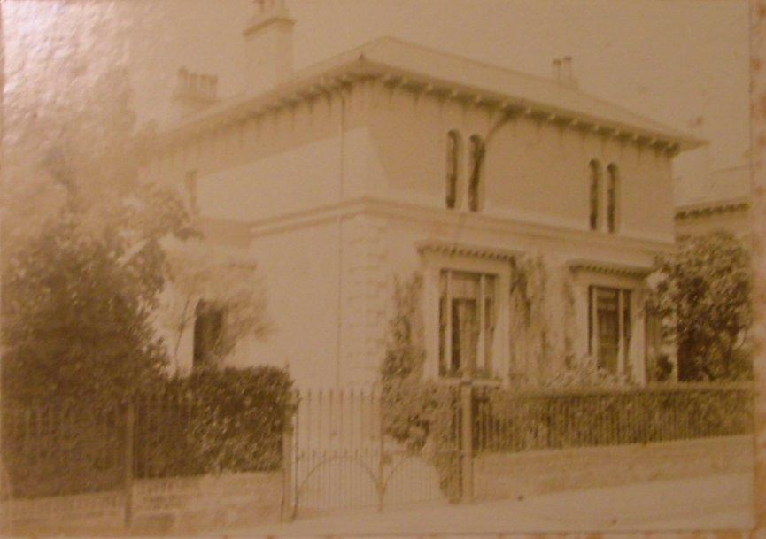

The **Acotts** were an Oxford family of builders, printers and tradesmen. One branch settled in Exeter, where **Gladys Lucy Acott** grew up and married the dentist [Clifford Marking Silver](Clifford-Marking-Silver/). Most of what is known about them comes from two sources: Edwin Acott's [family-history letters of 1942](Acott-Letters), and the photographs that [David Silver](David-Silver/) saved from his parents' house in Velwell Road, Exeter, "when my mother died". In 1998–99 David wrote what he knew on the backs of those photographs, some of them addressed "For Tamsin, Bridget & Candy", his three daughters. This page gathers the people, in order of generation, with their pictures.

---

## Pages, in date order

- **1781–1942** · [The Acott Letters](Acott-Letters): Edwin Acott's two letters of 1942 on the family's history, from Edward Acott, an Oxford builder born in 1781, to his own Victorian boyhood.
- **1874–1876** · [Letters from Edgar Vernon Acott](Acott-Family/Edgar-Vernon-Acott): two letters by Rupert's younger brother, secretary to the Oxford professor of Anglo-Saxon, written two years before he died at about twenty.
- **1882–1883** · Edwin Acott's photograph albums (described [below](#edwin-joseph-acott-b-1861)).
- **c. 1905** · Charlotte Acott's room at Mona Lodge, photographed by Clifford Silver (below).

---

## Charles Henry Acott (1825–1870) and Anne Amelia Baker

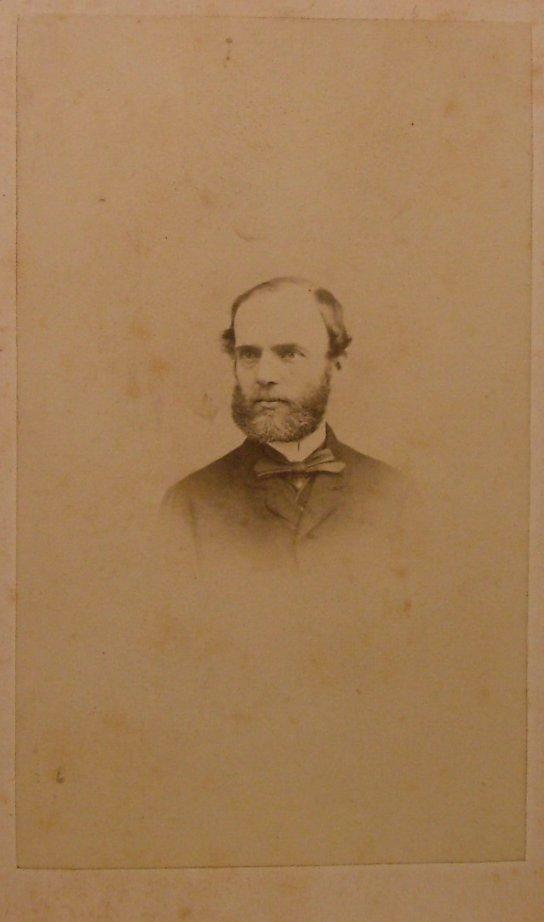

**Charles Henry Acott** was born in Oxford on 7 June 1825, the son of **Edward Acott** (1781–1858), a builder and carpenter at Gloucester Green, and Mary Weston of the Fyfield farming family. At fourteen he was apprenticed to Thomas Combe at the Oxford University Press. He lost his right thumb when a powder flask exploded in October 1849, ran a printing scheme with his brother-in-law Ingram Shrimpton (who later emigrated and founded the *Timaru Herald* in New Zealand), and finished as Overseer on the Classical Side of the University Press. He died of consumption on 19 August 1870, aged 45, leaving thirteen children.

His wife **Anne Amelia Baker** (1828–1915) came from the **Bakers**, yeoman farmers at Bampton in Oxfordshire. David labelled her photograph "Ann Acott, wife of Charles Henry Acott and mother of Rupert".

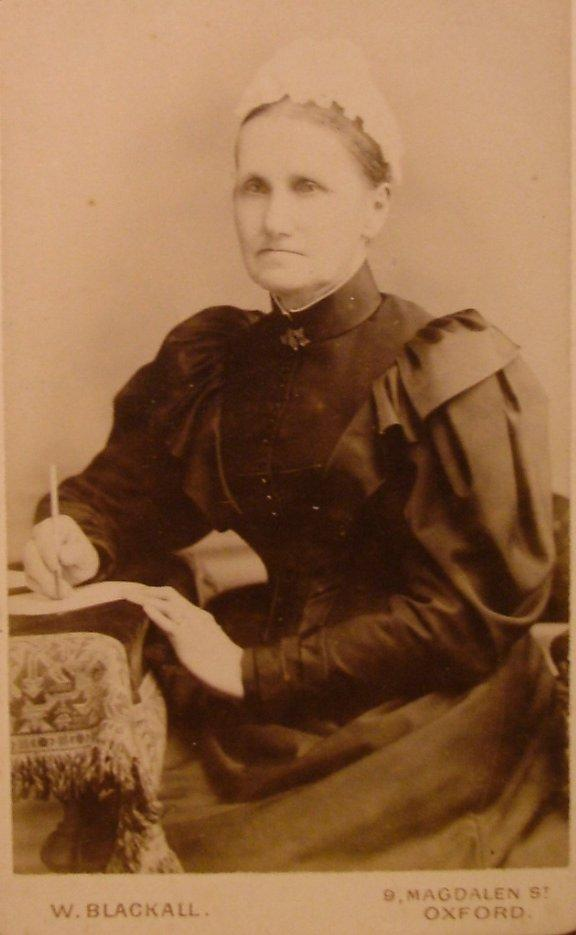

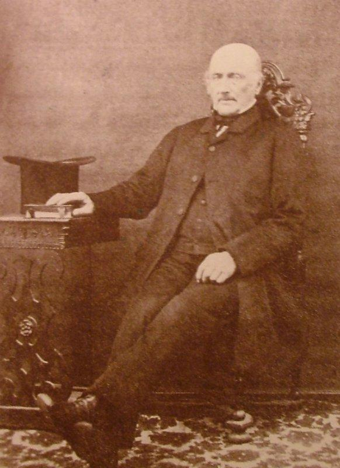

Her father is in the photographs too. A note on the back of his portrait reads: "My great grandfather on my father's mother's side. Yeoman farmer… Churchwarden of Bampton for 50 years." He is the Charles Baker (1792–1884) of Edwin's letter, or his father John.

**Their children** (from Edwin's 1942 letter): Charlotte Jane (1851–1932), Charles Henry (1852–71), **Rupert Philip** (1853–1941), Arthur Edward (1855–79), **[Edgar Vernon](Acott-Family/Edgar-Vernon-Acott)** (1856–76), **Sydney Mark** (1858–1913, who kept a music shop at 126 High Street, Oxford), John Allan (b. 1859, who went to Canada), **Edwin Joseph** (b. 1861), **Howard Spencer** (1865–1905), Edith Grace (b. 1867) and others. David remembered his grandfather saying that the brothers "all played cricket and made up a team. His sisters joined in. Bowling was by 'ROUND ARM'."

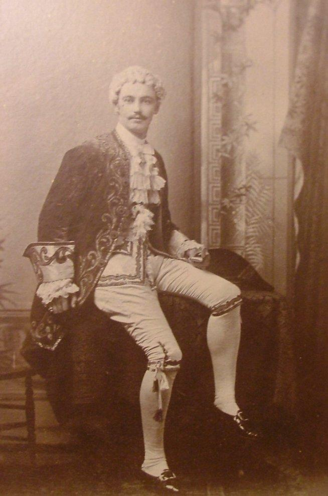

*"Uncle Howard Acott as Charles Surface"*, from Sheridan's *The School for Scandal*. Howard Spencer Acott (1865–1905) was Rupert's brother.

---

## Rupert Philip Acott (1853–1941) and Charlotte Rowell

**Rupert Philip Acott**, Gladys's father, was born at Bampton on 24 October 1853. He trained as a draper and worked in Oxford, Warminster and Bristol, where in 1874 he was at **Baker, Baker & Co.**, Wine Street. His brother Edgar's letters seem to call him "Phil". He married **Charlotte Rowell** (1851–1921), whom Edgar wrote to as "Charlie" when she was working for a draper in Cirencester. They settled in **Exeter** at **Mona Lodge**, Lyndhurst Road, St Leonards (Wonford), an Italianate villa with lions on the gateposts. After Charlotte died in 1921, Rupert moved to **Rosapenna** in Topsham, where he died on 3 February 1941.

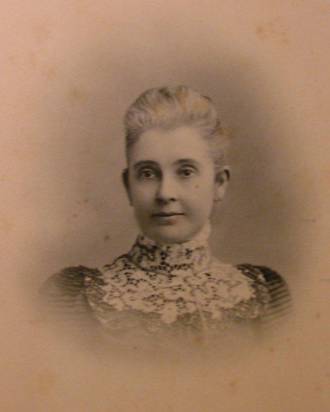

On the back of this portrait David wrote: *"For Tamsin, Bridget & Candy. This was my grandmother (Acott). She lived at Mona Lodge (it exists) Lyndhurst Road, Wonford, Exeter… My grandfather went to live in Topsham at ROSAPENNA (still exists) when his wife died."*

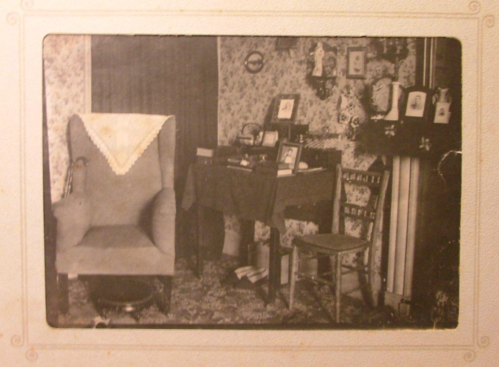

*"This photograph is on very thin easily torn paper. It is of my grandmother's room (Charlotte Acott)… about 1905. My father Clifford Marking Silver (dental surgeon) 3 Bedford Circus (until 1942) took the photograph when he was engaged to be married to Rupert Philip Acott's daughter, my mother Gladys Lucy Acott."* (David)

**Their children** included **Lionel**, **Muriel**, a third child David calls "Chest", **[Gladys Lucy](Gladys-Silver/)** and **Dorothy Vernon** (born about 1884).

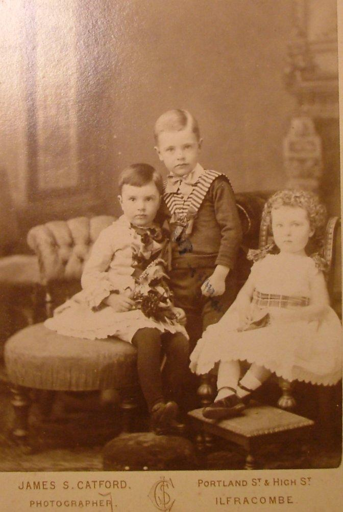

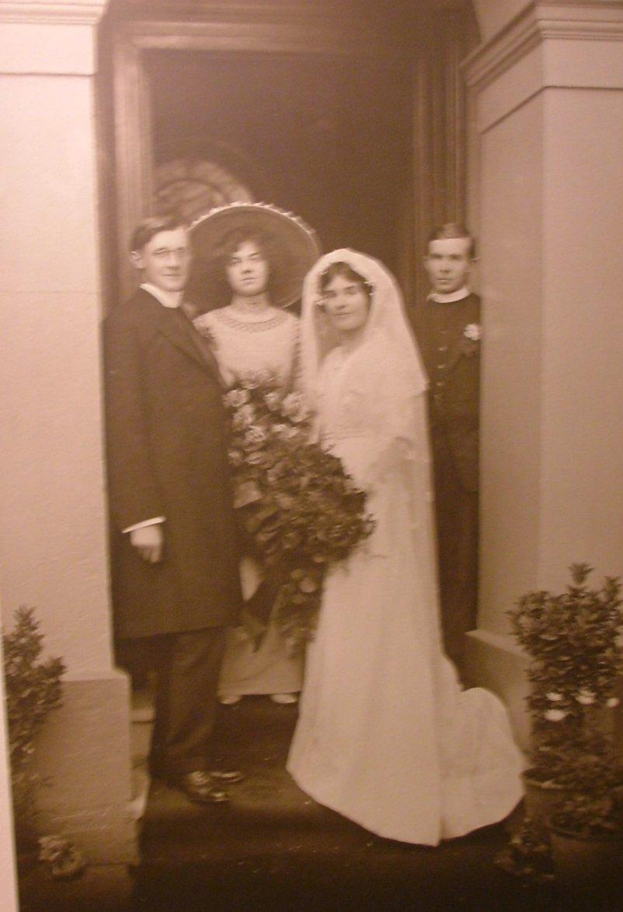

**Muriel** married the **Rev. Basil Scholfield** at Mona Lodge. David's note: *"This is the wedding of the Reverend Basil Scholfield and Muriel Acott. I think the bridesmaid may be Dorothy… at Mona Lodge (lions on the gate posts)."* It was Muriel who asked her uncle Edwin for the family history in 1942, and the [Acott Letters](Acott-Letters) came down through her son **Peter Scholfield**, who died at Ashburton in 1998.

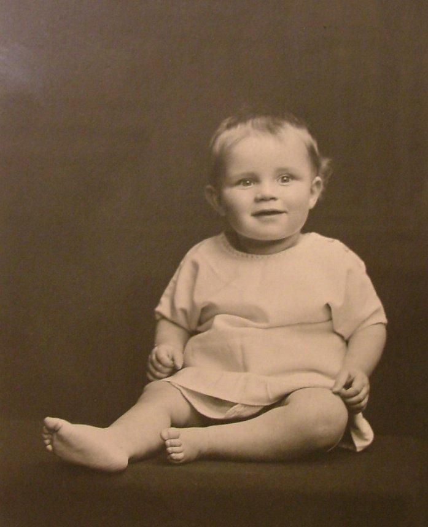

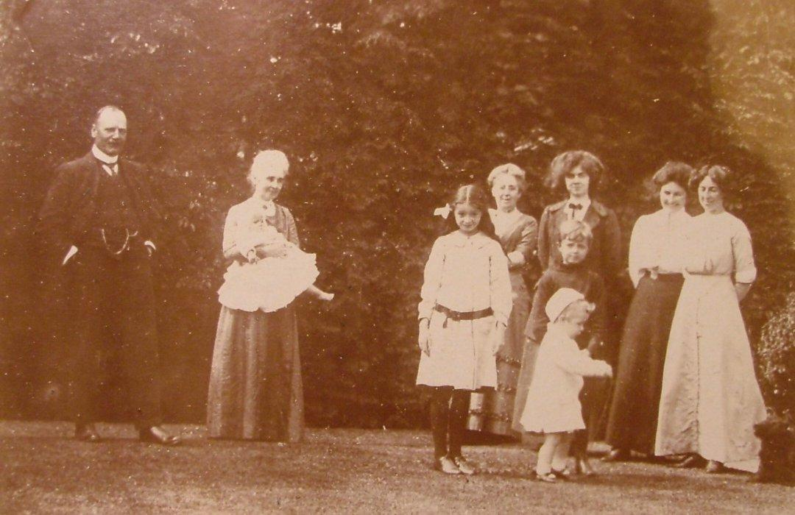

*"R.P. Acott, Mrs Acott (Rowell). Small children James, Lavender & Philip Silver 1916. Larger girl Muriel. Aunty Tessie(?), Dorothy, Gladys Acott."* (David)

---

## Edgar Vernon Acott (1856–1876)

Rupert's younger brother Edgar was secretary to **Dr Joseph Bosworth**, the Oxford professor compiling the *Anglo-Saxon Dictionary*. His two surviving letters, a cheerful one to Rupert in 1874 and one to Charlotte in 1876, written while he was recovering from bleeding from the lungs, are transcribed with their scans on **[Letters from Edgar Vernon Acott](Acott-Family/Edgar-Vernon-Acott)**. He died later in 1876, aged about twenty.

---

## Edwin Joseph Acott (b. 1861)

Edwin, a clerk with the Great Western Railway for forty-five years, wrote the [1942 family-history letters](Acott-Letters) to his niece Muriel. Two of his Victorian photograph albums survive among David's photos, inscribed **"Edwin J. Acott, Oxford, 2.8.82"** and **"Edwin J. Acott, Oxford, June 14th 1883"**. They are filled with bought views captioned and dated in his hand: Salisbury Cathedral (May 1881), Bristol Cathedral and the docks, Clifton Suspension Bridge, Exeter Cathedral, Dawlish (May 1881), Tintern Abbey and Raglan Castle. They read as a young railwayman's record of his travels on the GWR.

---

*Photographs from the Old Silver photos collection, saved by David Silver. Notes in quotation marks are David's own, written on the backs in 1998–99.*
