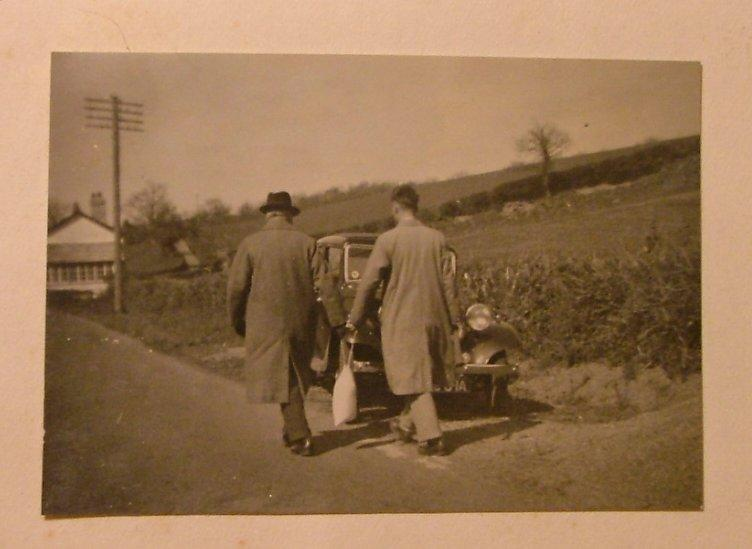

*← [Silver Family Archive](./)*

**Clifford Marking Silver** was a dentist in Exeter, with his surgery in Bedford Circus, the Georgian circus off the High Street. With his wife [Gladys Lucy Silver (née Acott)](Gladys-Silver/) he brought up six children at **Tresillian**, an 1899 Arts & Crafts house in West Avenue. He was a keen photographer and gardener, and passed both enthusiasms on to his sons, whose letters home from school are full of cameras, films and plans for the garden. On the night of 3–4 May 1942, in the Exeter Blitz, Tresillian was raked by cannon fire with Clifford and Gladys inside, and the surgery was damaged in the same raids. Bedford Circus was later demolished. He was Jago Silver's great-grandfather.

**Family.** Wife: [Gladys](Gladys-Silver/). Father: James Silver (1814–1885). Children: [James Clifford](James-Clifford-Silver/), [Lavender Charlotte](Lavender-Silver/), [Philip Sidney](Philip-Silver/), [Christopher Patrick](Christopher-Silver/), [David Rodney](David-Silver/) and Rosemary.

→ The full biography: **[Clifford Marking Silver: biography](Clifford-Marking-Silver/Biography)**

---

## Family photographs

*From the photographs David Silver saved from his parents' house; notes in quotation marks are David's own. Unlabelled prints identified by Tamsin and Andy Titcomb, 2026.*

---

## Pages, in date order

- **1773–1832** · [Bedford Circus](Clifford-Marking-Silver/Biography#bedford-circus), where his dental practice stood, is built.
- **1899** · [Tresillian](Clifford-Marking-Silver/Biography#tresillian), the family home, is built.
- **c. 1905** · [Student at the Royal Dental Hospital](Clifford-Marking-Silver/#family-photographs), Leicester Square, and engaged to Gladys Acott.
- **c. 1906–09** · [His wedding to Gladys](Clifford-Marking-Silver/#family-photographs).
- **1914–1918** · [The Exeter Volunteers](Clifford-Marking-Silver/#family-photographs).
- **c. 1926** · [The family on a beach](Clifford-Marking-Silver/#family-photographs), and his children's own pages: [James](James-Clifford-Silver/), [Lavender](Lavender-Silver/) and [Philip](Philip-Silver/).
- **1930s** · Christopher photographs [Tresillian and its garden](Christopher-Silver/UK#exeter) on glass plates.
- **1936** · [Christopher's letter home from Bruton](Clifford-Marking-Silver/Biography#clifford-in-his-sons-letters) to his parents (the letter itself is on [Christopher's biography](Christopher-Silver/Biography#bruton-1936)).
- **1937–1942** · [The Bruton Letters](Bruton-Letters): David's letters home to "C. M. Silver Esq." and his wife, full of cameras, gardens and the toy theatre.
- **1942** · [The Exeter Blitz](Clifford-Marking-Silver/Biography#the-exeter-blitz): Tresillian is wrecked and the surgery damaged. David's [watercolour and account of the raid](David-Silver/Biography#tresillian-and-the-exeter-blitz).
- **1943–1947** · [Letters from the RAF](David-Silver/RAF-Letters/): David's letters home to his parents at Tresillian.
- **1947–1953** · [Letters from Bristol](Bristol-Letters): David's letters home from architecture school.
