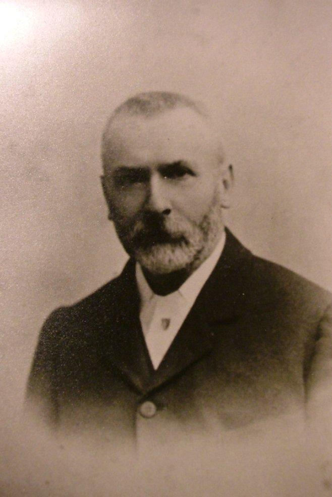
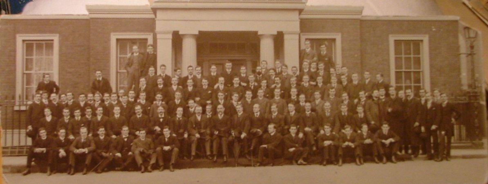
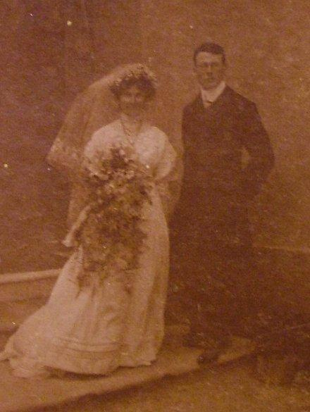
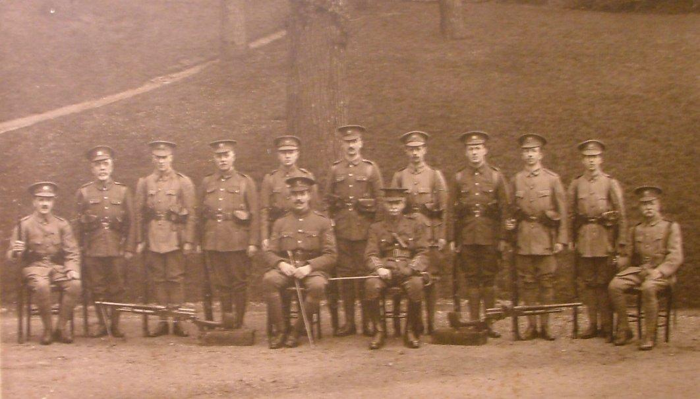
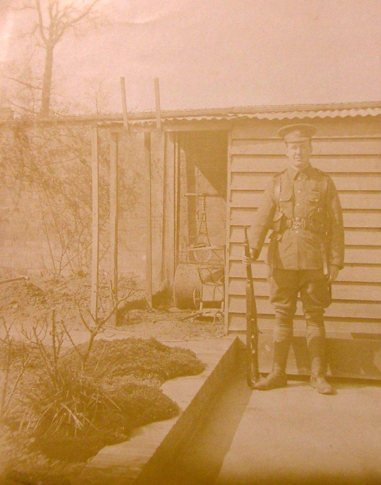
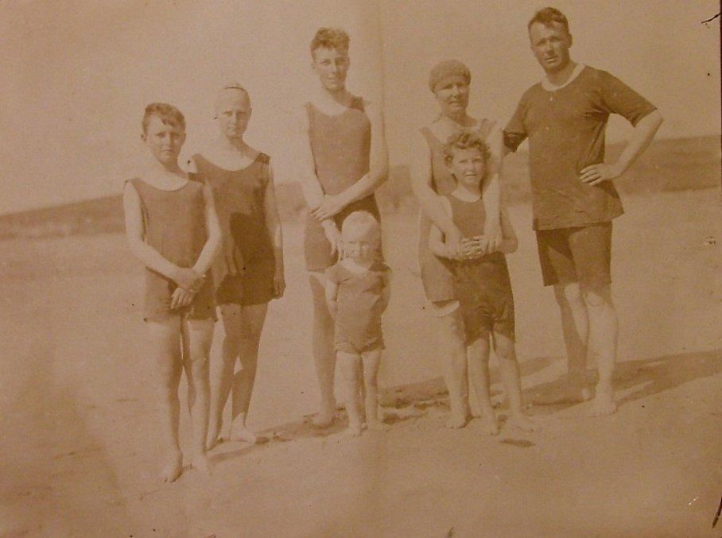
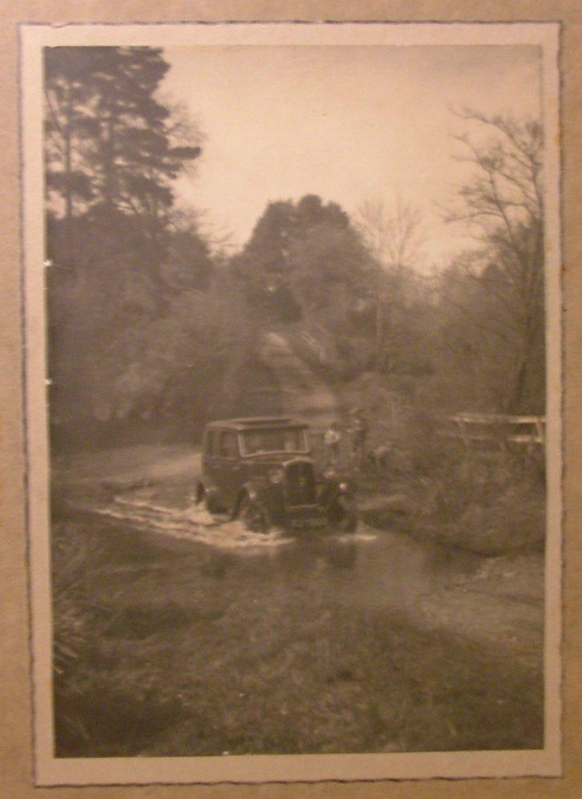
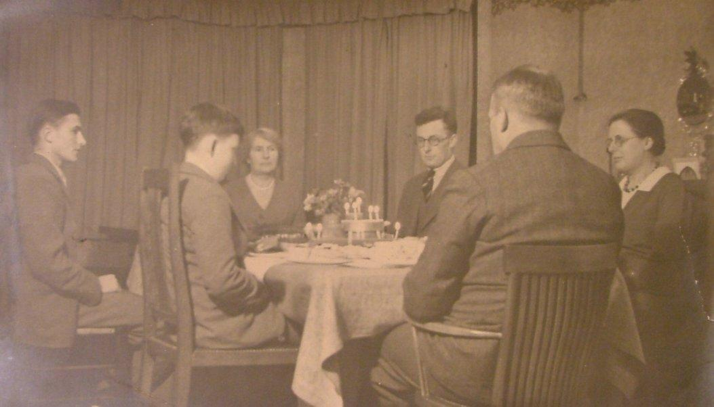
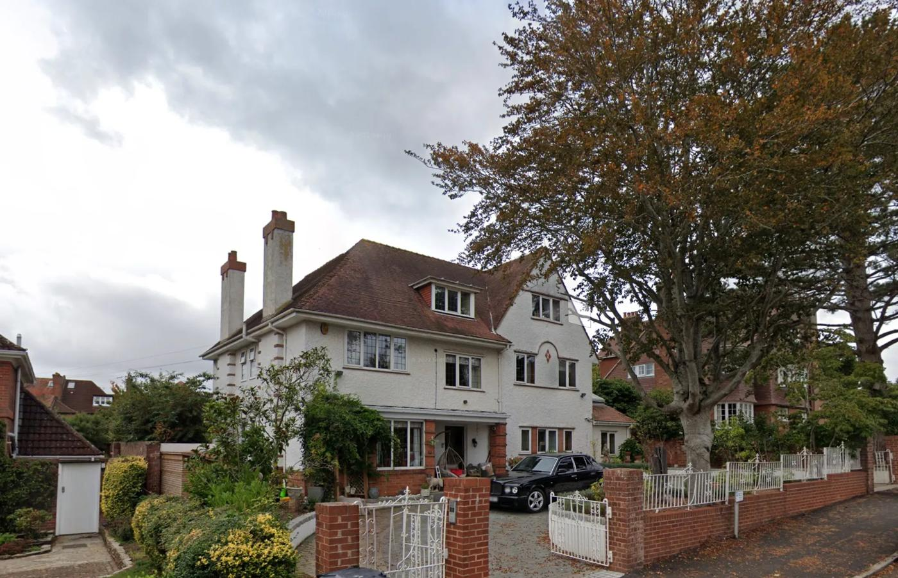

---
aliases:
  - Clifford-Marking-Silver/Biography
title: "Clifford Marking Silver"
description: "Clifford Marking Silver, Exeter dentist, of Tresillian, West Avenue: father of Christopher and David Silver. His life, family photographs and every page about him, in date order."
tags:
  - family
  - people
---

*← [Silver Family Archive](./)*

*Places on this page are on the [Exeter and Topsham map](Places/Exeter-and-Topsham-Map).*

**Clifford Marking Silver** was a dentist in Exeter, with his surgery in Bedford Circus, the Georgian circus off the High Street. With his wife [Gladys Lucy Silver (née Acott)](Gladys-Silver/) he brought up six children at **Tresillian**, an 1899 Arts & Crafts house in West Avenue. He was a keen photographer and gardener, and passed both enthusiasms on to his sons, whose letters home from school are full of cameras, films and plans for the garden. On the night of 3–4 May 1942, in the Exeter Blitz, Tresillian was raked by cannon fire with Clifford and Gladys inside, and the surgery was damaged in the same raids. Bedford Circus was later demolished. He was Jago Silver's great-grandfather.

## Family

- **Wife:** Gladys Lucy Silver (née Acott), of an Oxford family of builders and printers, one branch of which settled in Exeter. Her family's history is told in [The Acott Letters](Acott-Letters), written in 1942 by Edwin Acott to his niece Muriel; Gladys was Muriel's younger sister, both daughters of Rupert Philip Acott of Mona Lodge, Exeter (see [The Acott Family](Acott-Family/)). Her birthday was 23 June: David wrote to wish her "Many happy returns" from school (in c. 1939 and 1942).
- **Father:** James Silver (1814–1885).
- **Children:** [James Clifford](James-Clifford-Silver/), [Lavender Charlotte](Lavender-Silver/), [Philip Sidney](Philip-Silver/), [Christopher Patrick](Christopher-Silver/) (21 April 1920 – 12 November 2012), [David Rodney](David-Silver/) (2 January 1924 – 19 April 2003) and Rosemary.

## Family photographs

David Silver saved his parents' photographs from their house in Velwell Road, and in 1998–99 wrote what he knew on the backs. Unlabelled prints were identified by Tamsin and Andy Titcomb in 2026. They add:

- Clifford was born in **1880**, the son of **James Silver** (1814–1885).
- He trained at the **Royal Dental Hospital, Leicester Square**, about 1905–06, and practised at **3 Bedford Circus "until 1942"**.
- He was engaged to Gladys Lucy Acott around 1905, when he photographed her grandmother's room at Mona Lodge.
- He served in the **Exeter Volunteers** in the First World War: "meant to be available & I think even in France if everything got to a terrible state. It never did — we won in both wars." (David)
- In about 1932 he drove through the **watersplash at Yettington**, and in 1936 he bought a new **Austin, AFJ 960**, which was sold before the Blitz.

## The dental practice

Clifford practised as a dentist in **Bedford Circus**, in the centre of Exeter, separate from the family home. The surgery, like Tresillian, was damaged in the air raids of May 1942.

### Bedford Circus

Bedford Circus was one of the finest pieces of Georgian town planning in England: an ellipse of red-brick townhouses set round a private railed garden of mature trees, just off the High Street and a stone's throw from the cathedral. It stood on the site of Exeter's medieval Dominican friary, which after the Dissolution became Bedford House, the town house of the Russell family, later Dukes of Bedford.

- **1773.** The builder Robert Stribling laid the first stone on 27 May 1773 and built a crescent of fourteen houses, facing the cathedral, over the remains of Bedford House. The workmen dug up medieval bones, lead coffins and pieces of the old friary church. The Russell coat of arms from Bedford House's porch was set into the new façade.
- **1825–1832.** About fifty years later, T. Horrell completed the circus with a facing crescent of nine matching houses and a small neo-Classical chapel, finished in 1832. Each house had an arched doorway between columns, with a fanlight above, and white stone bands ran between the floors. The whole scheme was entered from the High Street by Bedford Street.
- **4 May 1942.** In the Exeter Blitz, fire spread from the burning High Street into the Circus. Many houses were gutted, though their walls stood, and a few escaped with broken windows and lost slates.
- **After the war.** The city council chose not to restore it. The shells and the surviving houses were demolished, the railings and trees removed and the street plan erased; the chapel walls lasted until 1949. The planner Thomas Sharp laid out Princesshay, said to be England's first pedestrian shopping precinct, on the site. It was rebuilt again in 2005–2007, and the historian W. G. Hoskins later called the demolition an act of vandalism.

Since the whole Circus was cleared, Clifford's practice cannot have returned there. Where he practised after 1942 is not yet known.

*Source: "[The Destruction of Bedford Circus](https://demolition-exeter.blogspot.com/2010/09/destruction-of-bedford-circus.html)", Demolition Exeter blog, 26 September 2010, which has period photographs of the Circus before and after the raid.*

## Tresillian

The family home was **Tresillian**, near the top of West Avenue in Exeter: an 1899 house by an architect David described as "a contemporary of Voysey", with white roughcast walls, a red-tiled roof, a garden-side porch on heavy timber posts with a vine over it, a greenhouse, and a long garden running back to a garage on the lane behind. Christopher photographed the house and garden many times on glass plates (see [Christopher Silver — UK](Christopher-Silver/UK)).

The garden was clearly a passion. Christopher's photographs show a carefully planted rockery and a greenhouse full of tomatoes and cacti, and the boys' letters from school are full of the garden: Christopher's crocuses by the greenhouse (1936), the bamboos his father was trying to establish, and the concrete rabbit Clifford wanted to cast for the garden pond, for which David bought him a rabbit-shaped jelly mould as a present in the summer of 1938 or 1939.

## The Exeter Blitz

On the night of **3–4 May 1942**, in the Exeter Blitz, Tresillian was raked by cannon and machine-gun fire from German bombers. According to David, a barrier of sandbags under the porch and removable steel sheets over the windows saved his parents' lives. One cannon shell went right through the house and down the garden. The house was uninhabitable for months, and many houses on the opposite side of the road took direct hits.

David, then at school at Bruton, wrote to his parents five days later: *"It is quite useless for me to try to say how glad I am you are safe, or how sorry I am that you had such a ghastly time… your extraordinary good fortune in being unhurt more than counterbalances the misfortune of losing the houses."* The "houses" were most likely the family home and the surgery in Bedford Circus, and he went on to ask, *"as regards the practice, will you retire Daddy? or what?"* He hoped, too, that his parents might retire to "a small house in the country". By 21 June 1942 they were back at Tresillian, and David hoped they would get a Morrison table-shelter. The house was later repaired; David painted it while waiting to join the RAF, and his watercolour and account of the raid are on [his page](David-Silver/).

## Clifford in his sons' letters

Clifford appears throughout the letters Christopher and David sent home from **King's School, Bruton** in Somerset, which they addressed to "C. M. Silver Esq." or "Mrs G. L. Silver" at Tresillian. Read together, they show a father who shared his sons' enthusiasms:

- **Photography.** Clifford was a keen photographer. David compares cameras with his ("a £9 Voigtlander like yours Daddy"), discusses films and exposure tables with him, asks whether he has tried printing paper in the viewfinder of his camera, and wonders whether his "daylight enlarger" would work. Both sons became keen photographers, and Christopher's glass-plate archive is the heart of this site.
- **Making things.** David sends him designs and ideas, from a model steam car to the episcope he wanted for Christmas in 1937, and talks over the scenes his father had suggested for his toy theatre.
- **Health.** Several letters hope "Daddy" is better after illness, and in 1941 David mentions sharing his father's "liverish turns, when I can't see anything".
- **Holidays.** In 1936 Christopher urged his parents not to put off a holiday on his account, and around November 1937 they stayed at Percival's Hotel, West Worthing.

The letters themselves are transcribed in full: Christopher's of 1936 on [his page](Christopher-Silver/#bruton-1936), and David's of 1937–1942 as [The Bruton Letters](Bruton-Letters).

---

*← [Silver Family Archive](./) · [Christopher Patrick Silver](Christopher-Silver/) · [David Silver](David-Silver/) · [The Acott Letters](Acott-Letters) · [The Bruton Letters](Bruton-Letters)*

---

## Pages, in date order

- **1773–1832** · [Bedford Circus](Clifford-Marking-Silver/#bedford-circus), where his dental practice stood, is built.
- **1899** · [Tresillian](Clifford-Marking-Silver/#tresillian), the family home, is built.
- **c. 1905** · [Student at the Royal Dental Hospital](Clifford-Marking-Silver/#family-photographs), Leicester Square, and engaged to Gladys Acott.
- **c. 1906–09** · [His wedding to Gladys](Clifford-Marking-Silver/#family-photographs).
- **1914–1918** · [The Exeter Volunteers](Clifford-Marking-Silver/#family-photographs).
- **c. 1926** · [The family on a beach](Clifford-Marking-Silver/#family-photographs), and his children's own pages: [James](James-Clifford-Silver/), [Lavender](Lavender-Silver/) and [Philip](Philip-Silver/).
- **1930s** · Christopher photographs [Tresillian and its garden](Christopher-Silver/UK#exeter) on glass plates.
- **1936** · [Christopher's letter home from Bruton](Clifford-Marking-Silver/#clifford-in-his-sons-letters) to his parents (the letter itself is on [Christopher's biography](Christopher-Silver/#bruton-1936)).
- **1937–1942** · [The Bruton Letters](Bruton-Letters): David's letters home to "C. M. Silver Esq." and his wife, full of cameras, gardens and the toy theatre.
- **1942** · [The Exeter Blitz](Clifford-Marking-Silver/#the-exeter-blitz): Tresillian is wrecked and the surgery damaged. David's [watercolour and account of the raid](David-Silver/#tresillian-and-the-exeter-blitz).
- **1943–1947** · [Letters from the RAF](David-Silver/RAF-Letters/): David's letters home to his parents at Tresillian.
- **1947–1953** · [Letters from Bristol](Bristol-Letters): David's letters home from architecture school.
