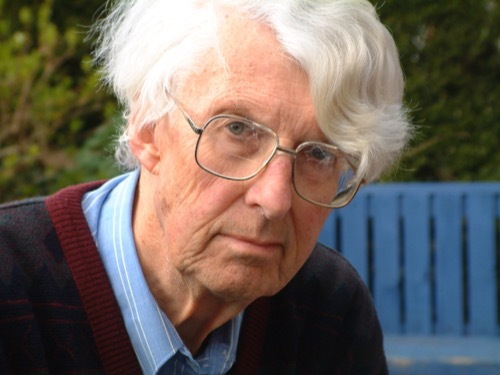

*← [Silver Family Archive](./)*

**David Rodney Silver** (2 January 1924 – 19 April 2003) was an architect, a wartime RAF engine fitter and, by his grandson's account, a frustrated artist. He was born in Exeter, the son of the dentist [Clifford Marking Silver](Clifford-Marking-Silver/) and [Gladys Lucy Silver (née Acott)](Gladys-Silver/), and grew up at Tresillian in West Avenue. He boarded at King's School, Bruton, from 1937 to 1942, spent a couple of terms at Exeter School of Art, and then served four years in the RAF, overhauling and test-running Merlin engines. After demob in 1947 he trained at the Bristol School of Architecture, where he met [Anthea Leigh](Anthea-Silver/); they married at the end of 1952. He spent most of his career as an architect in the civil service, and in retirement he and Anthea lived in Wadebridge, Cornwall, where he went to watercolour classes and filled his letters with pen sketches. He was Jago Silver's maternal grandfather, known to the family as **Grandpa**.

**Family.** Parents: [Clifford](Clifford-Marking-Silver/) and [Gladys](Gladys-Silver/). Brothers and sisters: James, Lavender, Philip, [Christopher](Christopher-Silver/) and Rosemary. Wife: [Anthea](Anthea-Silver/). Three daughters. Grandson: [Jago](Jago-Silver/).

→ The full biography, with his paintings, sketches and letters to his grandson: **[David Silver: biography](David-Silver/Biography)**

---

## Pages, in date order

- **1937–1942** · [The Bruton Letters](Bruton-Letters): 68 letters home from boarding school, from a homesick thirteen-year-old to the Exeter Blitz. See also [King's School, Bruton](Kings-School-Bruton) and the boys he knew on its war memorial.
- **May 1942** · [Tresillian and the Exeter Blitz](David-Silver/Biography#tresillian-and-the-exeter-blitz): his watercolour of the bombed house and his account of the raid.
- **1943–1947** · [Letters from the RAF](David-Silver/RAF-Letters/): letters home from eight RAF stations, basic training to demob.
  - Oct 1943 – Jan 1944 · [Skegness](Skegness-Letters)
  - Jan – May 1944 · [Cosford](Cosford-Letters)
  - May – June 1944 · [Little Horwood](Little-Horwood-Letters) (including D-Day)
  - June 1944 – Apr 1945 · [Oulton](Oulton-Letters)
  - Aug 1945 – Jan 1946 · [Oakington](Oakington-Letters)
  - Spring – summer 1946 · [Henlow](Henlow-Letters)
  - July 1946 – Mar 1947 · [Isle of Man](Isle-of-Man-Letters)
  - June – July 1947 · [Wellesbourne Mountford](Wellesbourne-Letters)
- **Summer 1944** · [Still life at Tresillian](David-Silver/Biography#still-life-summer-1944), painted on leave alongside his brother Christopher.
- **1947–1953** · [Letters from Bristol](Bristol-Letters): architecture school, Anthea, and marriage in December 1952.
- **c. 1951** · [Letters from France](France-Letters): a solo motorbike tour.
- **1953 onwards** · [Architect](David-Silver/Biography#architect) and [Wadebridge](David-Silver/Biography#wadebridge).
- **c. 1994** · [Grandpa's Second World War tape](WWII-Interview): his own account of the war, recorded for his grandson's school project, with audio and transcript.
- **1996–2001** · [In his own words](David-Silver/Biography#in-his-own-words): letters to his grandson, with pen sketches of Spitfires, Brittany and the Eden Project.
- **2003** · [Last words](David-Silver/Biography#last-words).

## Elsewhere in the archive

- His brother Christopher photographed him as a young man: [People](Christopher-Silver/People).
- Anthea's memoir of her Topsham childhood: [A Topsham Childhood](A-Topsham-Childhood).
- His mother's family: [The Acott Letters (1942)](Acott-Letters).
