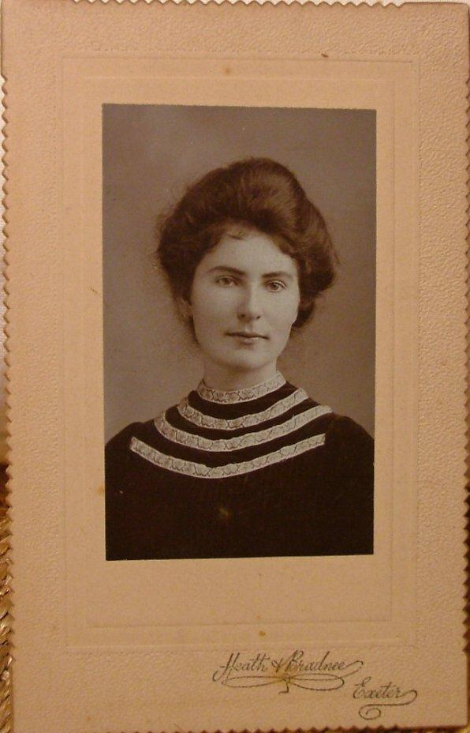
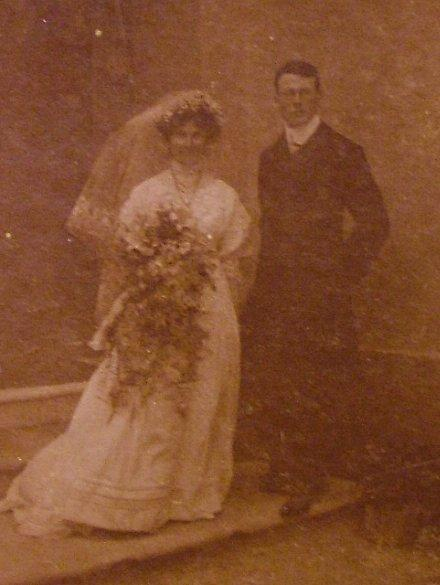
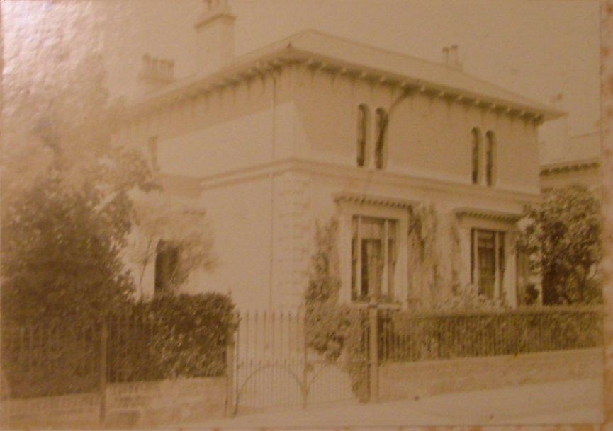
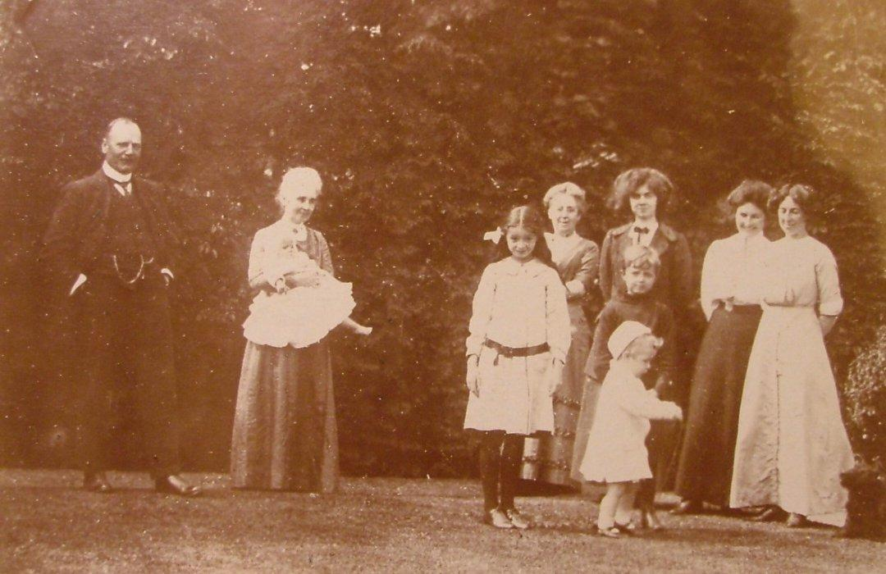
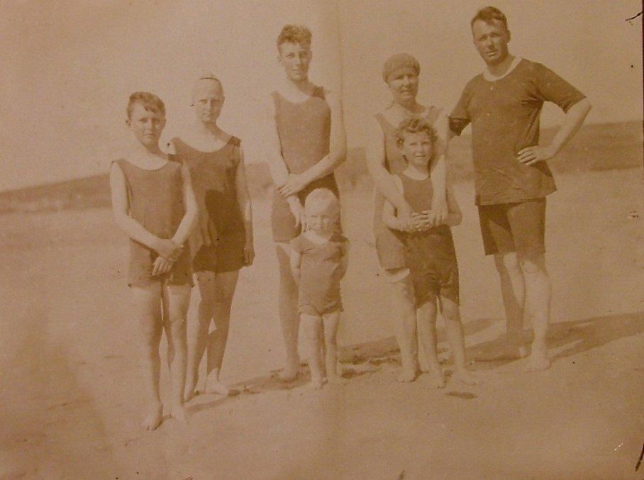

*← [Silver Family Archive](./)*

**Gladys Lucy Silver**, née **Acott**, married the Exeter dentist [Clifford Marking Silver](Clifford-Marking-Silver/) and brought up their six children at Tresillian, West Avenue, Exeter. She was a daughter of **Rupert Philip Acott**, a draper, and grew up at **Mona Lodge**, Lyndhurst Road, Exeter. She came from the [Acotts](Acott-Family/), an Oxford family of builders and printers, one branch of which settled in Exeter; the family also descended from the Baker yeoman farmers of Bampton. Her birthday was 23 June, and her sons wrote home from school and the RAF to wish her many happy returns. She and Clifford were inside Tresillian when it was shot up in the Exeter Blitz of May 1942, and survived unhurt. She was Jago Silver's great-grandmother.

**Family.** Husband: [Clifford](Clifford-Marking-Silver/). Parents: Rupert Philip Acott and Charlotte Rowell (see [The Acott Family](Acott-Family/)). Sisters: Muriel and Dorothy. Children: [James](James-Clifford-Silver/), [Lavender](Lavender-Silver/), [Philip](Philip-Silver/), [Christopher](Christopher-Silver/), [David](David-Silver/) and Rosemary.

---

## Family photographs

More of her family, with their photographs, is on [The Acott Family](Acott-Family/).

---

## Pages, in date order

- **1781 onwards** · [The Acott Letters](Acott-Letters): Edwin Acott's two 1942 letters to his niece Muriel (Gladys's sister) on the family history, from Edward Acott, an Oxford builder born in 1781, to Edwin's Victorian Oxford boyhood.
- **1874–1876** · [Letters from Edgar Vernon Acott](Acott-Family/Edgar-Vernon-Acott), her uncle, to her father Rupert and her mother Charlotte.
- **c. 1905** · [Her grandmother's room at Mona Lodge](Acott-Family/#rupert-philip-acott-18531941-and-charlotte-rowell), photographed by Clifford when they were engaged.
- **c. 1906–09** · [Her wedding to Clifford](Clifford-Marking-Silver/#family-photographs).
- **1916** · [With her parents, sisters and first three children](Acott-Family/#rupert-philip-acott-18531941-and-charlotte-rowell) in the garden.
- **1937–1942** · [The Bruton Letters](Bruton-Letters): David's letters home, addressed to "Mrs G. L. Silver" as often as to his father.
- **1942** · [The Exeter Blitz](Clifford-Marking-Silver/Biography#the-exeter-blitz) at Tresillian.
- **1943–1947** · [Letters from the RAF](David-Silver/RAF-Letters/): David's letters home.
- **1947–1953** · [Letters from Bristol](Bristol-Letters): David's letters home, including his news that he and Anthea are to marry.
