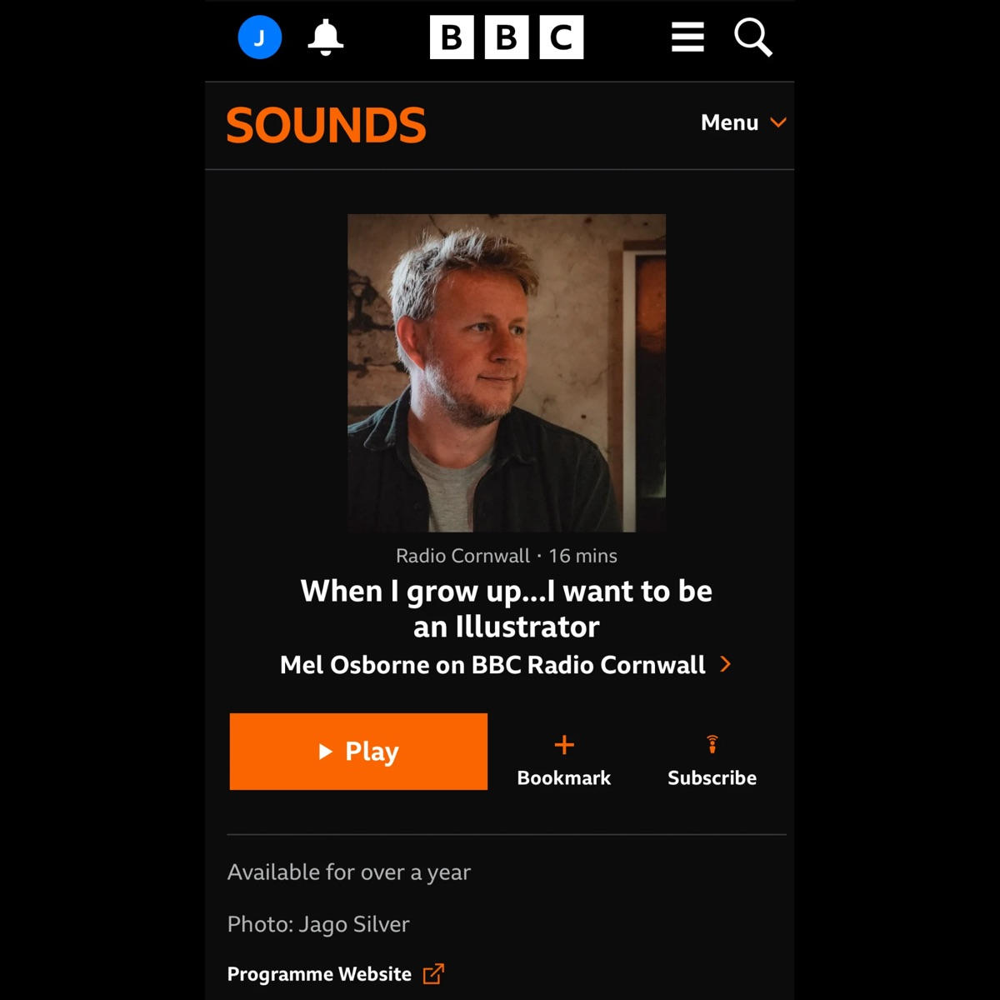
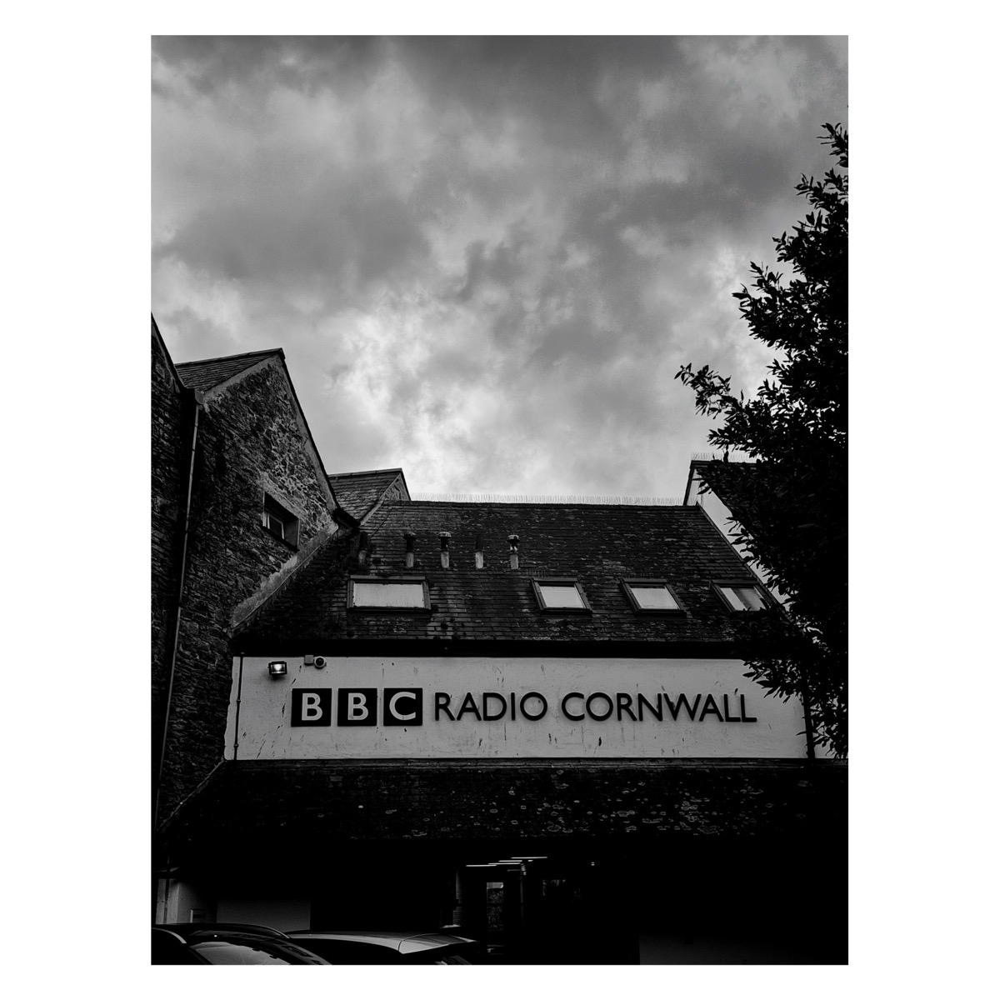

*← [Jago Silver](Jago-Silver/) · [Silver Family Archive](./)*

On **20 November 2026** Jago went to the BBC Radio Cornwall studio in Truro to record an interview with presenter **Mel Osborne** for *When I Grow Up*, the station's weekly feature on unusual careers. It was broadcast on **Saturday 21 November 2026** at 9.15am, and is on BBC Sounds as *"When I grow up...I want to be an Illustrator"*.

He starts where the programme always starts, with what he wanted to be as a child: Superman, then King Arthur, then an archaeologist. He tells how a summer spent drawing and playing with an early Photoshop led him to give up a place to read archaeology at Lampeter, and how a GNVQ at Truro College took him to the illustration degree at Falmouth. His parents had both been to art college, and an aunt who worked at a library kept him in ex-library picture books. At his degree show he was offered books by the Cornish storyteller Will Coleman and Oxford University Press, which published his first picture book, *Fig's Giant*. He goes on to talk about how he works, about AI, about working with authors such as Sally Lloyd-Jones, about the print shop he runs with his wife Alex, and about the books he is now writing himself.

<audio controls preload="none" src="audio/BBC-Radio-Cornwall-When-I-Grow-Up-2026.mp3" style="width:100%"></audio>

*The whole broadcast feature, 16 minutes.*

*The episode on BBC Sounds. The programme photo is Jago's own.*

*BBC Radio Cornwall in Truro, on the day of recording.*

**About the transcript.** Machine-transcribed, with the speakers named and a few clear mishearings corrected (Truro College, Lampeter, GNVQ). Otherwise the wording is as spoken, and (?) marks a doubtful hearing. Timestamps are minutes into the recording.

---

## Transcript

**Mel Osborne** 00:06
His job, Jago Silver, is a children's book illustrator. He's based in North Cornwall, and he's worked with best-selling authors and publishers around the world. I caught up with him yesterday and asked him, of course, as I always do, when you were young, what did you want to be when you grew up? And I particularly enjoyed his answers.

**Jago** 00:25
So I had a couple of potential career options when I was small that I was pretty certain about. The first was Superman. The second was King Arthur. Unfortunately, turned out neither of those were options.

**Mel** 00:41
Devastating.

**Jago** 00:42
It was. It was. Yeah, I'm still disappointed to be honest. And then, and then I was one of those annoying people at school who knew exactly what they wanted to do, and I wanted to be an archeologist.

**Mel** 00:53
Oh, okay. And yet, so what happened there then?

**Jago** 00:58
So I went through school planning to be an archeologist, I distinctly remember having a careers meeting. I think the poor careers advisor probably had a whole load of people who had no idea, and then I came in totally certain. Yes, I want to be an archeologist, and they flipped through a folder, and I could see they kind of it was alphabetical, and then they kind of paused, and they were like, "Have you considered being an architect?" And I realized they didn't have a, they didn't have a piece of paper for archeologist.

**Mel** 01:25
But you know, same first letter. Yeah,

**Jago** 01:28
really not the same at all. But

**Mel** 01:30
very much not.

**Jago** 01:31
I went to Truro College and I did A levels. I'd done really well in my GCSEs, and then I discovered that A levels were a lot harder. I

**Mel** 01:39
had the same experience. That jump was horrific. Yeah,

**Jago** 01:43
and there were a lot more interesting things going on. To be honest, I had a great social life and a girlfriend, and that all seemed a lot more interesting. But miraculously, I got a place to study archeology at Lampeter University, and then over the course of the summer, kind of realized I really wasn't reading all my archeological journals. I was messing around on the computer in a kind of very early version of Photoshop and drawing a lot. And my parents, who'd both been to art college, I think were kind of waiting for the penny to drop a bit. So I didn't take up my place. I went back to Truro College, and luckily, a fantastic guy called Martin Page let me on to his Art GNVQ course because I didn't have a GCSE in Arts, so I couldn't do A levels. And then I worked really hard for two years because I was two years older than everyone else, and I'd already done the kind of social side of college once. I was kind of really focused, did really really well, and got onto a place at Falmouth to study illustration, so that was kind of where the illustration part of it all began.

**Mel** 02:49
Okay, and at what point did you realize that illustration was the the avenue you wanted to pursue?

**Jago** 02:54
Well, again, I suppose that was during the GNVQ. I mean, I've always loved children's books. My parents had loads, and in fact, my auntie worked at a library when I was small, so I'd get all of the ex-library picture books from her. So I had a huge number of picture books, but I hadn't actually really considered illustration as a job until I talked to my lecturer and sort of said, "Oh, I kind of quite like fine art, but I kind of quite like graphic design." And he was kind of, "Well, there is this sort of thing that's almost a sort of bit in the middle of those two things, you know, illustration," and yeah, that just seemed to fit really well. And like I say, because of my interest in picture books, that seemed like a natural thing to follow.

**Mel** 03:38
It feels to me though like it it must be quite a competitive industry. It must have been quite hard to to get a foot in the door.

**Jago** 03:45
It should have been, and all of our lecturers kind of warned us at Falmouth that you know this is going to be tough. I think there were 50 people in my year. I think the course is a lot bigger now, and I think maybe five of us are still working as illustrators that I know of. But I was really lucky. My wife hates it when I say I was lucky. She says it was hard work. But at my degree show at Falmouth, I got offers from two publishers for books. One was a local guy called Will Coleman.

**Mel** 04:17
Ah, yeah, I know Will.

**Jago** 04:18
And everyone in Cornwall knows Will, yeah. So he was technically my very first commissioned publisher. I worked on three books of Cornish stories for him, but at the same time, publisher from Oxford University Press was there, and they signed me up for a two-book deal to do picture books with them.

**Mel** 04:38
Wow!

**Jago** 04:38
So that all kind of happened really fast.

**Mel**
Your final exhibition must have been incredible.

**Jago** 04:44
Yeah, I guess it made an impression, and actually, it was kind of Cornwall related because while I was still doing my degree, I got an illustration job with Cornwall Today magazine. So they published at the time stories each issue, and I got to illustrate them for six months. So I already had published work, which really seemed to impress the the picture book publishers. I think somebody else had already taken a chance. I was seen as less of a risk.

**Mel** 05:12
What was it like? Can you remember seeing your art published for the first time?

**Jago** 05:17
Yeah, it was quite surreal. I think thinking back, so my first published picture book was Fig's Giant by Oxford University Press, and I received a kind of a printed copy, but not bound. So you get a sort of loose leaf copy of your book before you get the real thing, and that was really exciting. I think because I work almost entirely digitally as well, so all of the work had been just on the screen up until that point. So then, seeing a physical copy arrive in the post was really exciting.

**Mel** 05:51
When you say you work digitally, can you explain to us what that entails?

**Jago** 05:57
I can try. It's changed a bit over the years. So when I was at university, I would always have this problem that I would draw pictures in pencil that I would really like, and then you'd have to paint over them to sort of finish them, and I would ruin them generally. And so initially, I just sort of developed this technique where I would draw something in pencil or ink and really like it, and I would scan into the computer literally just as a sort of backup. So it's like if I paint over it and I ruin it. Well, at least I've still got the drawing. And then I kind of figured out ways in Photoshop of effectively painting underneath the drawing, so you can kind of make the white bits of the drawing transparent, so you can only see the lines. So I would start coloring in sort of underneath the lines, which obviously you can't do with real paint. And then I kind of added various textures. I started scanning things in. I built up this kind of huge library of all sorts of textures, from real things I'd scanned in to photographs of things I'd taken. So it's a sort of combination of drawing and collage.

**Mel** 06:53
Wow, that sounds absolutely incredible. I guess the advances in technology you've had to keep on top of them,

**Jago** 07:02
yeah. So about 10 years ago, I switched entirely to doing everything on an iPad. I used to use a very big, expensive graphics tablet, like a huge sort of 32 inch screen that you can draw directly onto. That had to be connected up to a big, expensive computer. And then, yeah, about 10 years ago, when the iPad Pro with an Apple Pencil came out. It was way better,

**Mel**
oh wow,

**Jago**
and cheaper, and easier, and you can carry it with you. So ever since then, I've done pretty much everything on an iPad.

**Mel** 07:32
Does AI worry you? Because I know a lot of people in the creative industries are quite concerned about it.

**Jago** 07:37
Yeah, definitely. I think for people that kind of don't work in this industry, illustration is entirely based on licensing. So when I create artwork for a book, I own the artwork and I license the publisher to use it in that book. But unless I've agreed it beforehand, doesn't mean the publisher can do anything they like with it. You know, they can't, for example, print it on pencil cases or lunchboxes without me having agreed to it, and the whole industry works on that principle of licensing. So somebody creates something, they own the copyright in it, and then they license it to other people to do different things with. And AI has just sort of upended that entirely because the companies have basically taken everybody's work without paying for it,

**Mel** 08:17
(…)

**Jago** 08:18
and then allowed other people to use that work as a basis to make their own work for free, so it's really scary to sort of see where that might go.

**Mel** 08:26
Yeah, you could understand why he'd be concerned about, and really curious to find out what the process is like working with an author or publisher.

**Jago** 08:34
So, yeah, people often have a misconception about that. So, in general, what happens is that an author would submit their text to a publisher, and then the publisher goes out and finds the illustrator. And often you have no contact at all with the author. I've been quite lucky that I've done a whole series of books with an author called Sally Lloyd Jones, who lives in New York, but interestingly goes to Rock every year on holiday in Cornwall to meet with her family, so I've met her several times, and I think because she's become quite an established author, she gets quite a lot of say. But in general, there's no contact at all between the illustrator and the author. Everything is done via the publisher, and the author really doesn't get a lot of say about anything that happens. They've sort of handed their story over, and then it's up to the publisher and the illustrator to to do the next step.

**Mel** 09:23
Wow! And how would you describe your style of art? I mean, I'm sorry, I'm turning away from the mic because you brought some pictures in for me to look at. But you know, I said to you when I was looking at the pictures on your website, they just I just felt a real sense of peace from them. But they're also incredibly beautiful, and that's not just me blowing smoke. How how would you describe your style?

**Jago** 09:44
I don't know. I think that's really difficult. I mean, I think I've done various talks at universities and colleges and things, and often lots of students sort of are really concerned about finding their style. And I think it's it just sort of happens naturally in the sense that you know you get inspired by other people all the time. But even if you set out to try and copy another artist, which you know I wouldn't do, but it would be filtered through your own kind of abilities. You know the things you're better at, the things you're not so good at. So I think it's the sort of sum total of all of the things I've seen that have inspired me that have been filtered through what I'm able to do that ends up with my artwork looking the way it does, but I'm hopeless at trying to describe it.

**Mel** 10:32
It's a lot of nature in it as well. Yeah, yeah, just lovely. Is that inspired by?

**Jago** 10:38
I mean, a lot of it is inspired by Cornwall. Yeah, I mean, some of the picture books I've done have been quite explicitly, even though the the book themselves has nothing to do with Cornwall. If you look at the pictures, you can tell. So there's a lot of kind of Cornish-looking coastlines and things. And then in my own work that I do for my prints in my shop, a lot of it is either actual locations in Cornwall or it's places that could be in Cornwall, so yeah, that definitely comes into it.

**Mel** 11:04
And tell me about running the shop as well. I mean, that sounds like a lot of extra hard work on top of the day job.

**Jago** 11:10
Yeah, so that that kind of came about. I used to be a lecturer as alongside being an illustrator, so I did that for seven years at Truro College, and then when that was kind of coming to an end, my wife and I were sort of thinking there should be another way we could be earning a bit of a living doing this, and so we started looking into setting up an online shop, bought a printer, started making our own prints of my illustrations, and it kind of went from there. And now it's been going for 10 years. So

**Mel** 11:41
wow, tough trading times at the moment. Have you have you had that experience?

**Jago** 11:46
Yeah, definitely. I mean, I haven't done it now for a few years, but I used to do lots of kind of Christmas shows and things, and I've heard that even that is sort of not going as well as it used to. So yeah, definitely sales are slowing, unfortunately.

**Mel** 12:01
That kind of leads me on to the next question, which again I always ask everybody: What are the best bits of your job, and what are the worst bits of your job? And we'll start with the worst bits.

**Jago** 12:10
I mean, I think the worst bit is just the bit that nobody ever tends to consider, which is that you're self-employed, so you're entirely reliant on yourself to earn an income, so it's very insecure and unpredictable. But the flip side of that is obviously that I get to do more or less what I want a lot of the time. Each day can be quite different, so you know, some days I'll be packaging up orders for people, other days I can spend the entire day drawing, other days I can just go for a walk and go to the beach, and you know there's no set hours.

**Mel** 12:46
But there's never any off time either, is there? That's the flip side.

**Jago** 12:49
Yeah, there's no set hours, but the hours can go all day and night. A lot of my work is for American publishers in totally different time zones, so you get the sinking feeling when it's half past nine at night, and you suddenly get an email from the publisher, and it's midday where they are, so they're sort of hoping that you might get it done that day. And you're thinking, "Oh no!"

**Mel** 13:07
The best bits,

**Jago** 13:09
the best bits are just getting to do something that I really enjoy as an actual job. I still remember when I started my Art GNVQ all those years ago, kind of being astonished that I was actually getting to do this as part of the course. Like this was the work I think coming from sort of science A levels and stuff that felt so hard. Suddenly, kind of realizing, oh wow, no, this is this is the actual work. I I get to do this, and then you know, having done that for 20 years now, that's a pretty good thing.

**Mel** 13:39
And if you could go back, would you do it again?

**Jago** 13:42
Yeah, definitely. Yeah, yeah. It's very hard to imagine myself as an archeologist now. I still wouldn't mind being King Arthur. Yeah, that that one I'd go for. But yeah.

**Mel** 13:52
And what's next for you? What are the plans for 2027?

**Jago** 13:56
So currently, I mean, I've over my career so far, I've worked on 65 books, I think, in total. But I've never written one, so the last sort of year or so, I've been working on some ideas of my own, and that is a whole other level of difficulty. Yeah. So I've always been used to being working with a publisher when the book's already there and they're employing you to illustrate it, but trying to get your book in front of a publisher is is quite tricky.

**Mel**
Oh, really? Because you would think, having worked with them, you would have sort of you would think that open door, really.

**Jago** 14:31
No, it doesn't really work like that, sadly. No. So yeah, the first hurdle is getting them to look at it, and then after that, you have to convince them to publish it. So,

**Mel** 14:40
oh well, good luck. Have you written it?

**Jago**
I've written several, and they're all in various stages of trying to get people to publish them. So hopefully,

**Mel** 14:49
yeah. Oh well, please come back and let us know when that happens. We're going to be really positive about it when that happens.

**Jago**
Thank you. That would be lovely.

**Mel**
To hear about. Is there? Sorry, I think I said final question, but I do have one more. If there's anybody listening who who thinks this is a path they might like to go down, what advice would you give them?

**Jago** 15:08
I mean, the advice I was always given, and I tended to ignore, and I really only just got into it in the last I don't know three or four years, is keep a sketchbook, which all my teachers told me, and I kind of did it intermittently, and I never really stuck for some reason. But just have a sketchbook, take it everywhere, get over the kind of awkwardness of sitting somewhere and drawing something. Nobody really pays you much attention, and just like draw every single day with no excuses. Like it can only be for like five or 10 minutes. It doesn't have to be a massive commitment, but if you do it every single day, you really see improvements quickly. And being able to draw is the single most important factor in doing anything like this. So definitely do that.

**Mel** 15:52
Which is why it was definitely not a path I could go down. I can't even draw a stick man.

**Jago** 15:58
But people say that, and then I say, well, think about you know handwriting. That is a lot of really small, complicated shapes that you join up one after another very fluidly without even thinking about it. Drawing is exactly the same thing. It's just that people practice handwriting from the age of four or whatever, and they don't practice drawing in the same way.

**Mel** 16:17
Fair enough. Wasn't there? There's that saying, isn't there, about what it takes to make a genius, and it's you know 1% talent and 99% practice.

**Jago** 16:24
Yes, definitely. Yeah.

**Mel** 16:25
Well, you've clearly put the practice in. It's been so lovely to talk to you. Thank you ever so much, Jago (?), and best of luck with those books.

**Jago**
Thank you very much.

**Mel** 16:31
Illustrator Jago Silver, who was our When I Grow Up guest this week, just found so interesting. And if you get a chance to have a look at his his art. If you Google Jago Silver, it's really beautiful.
