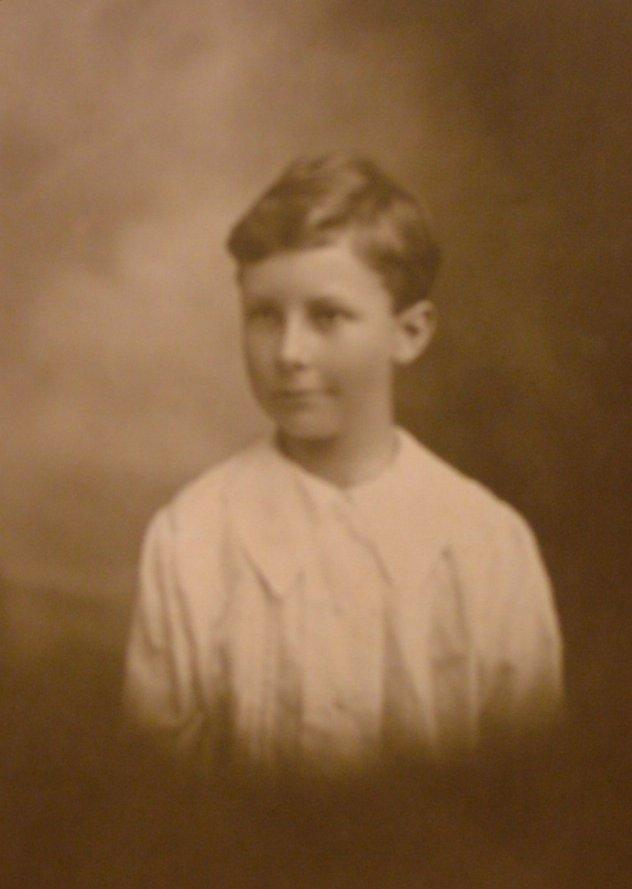
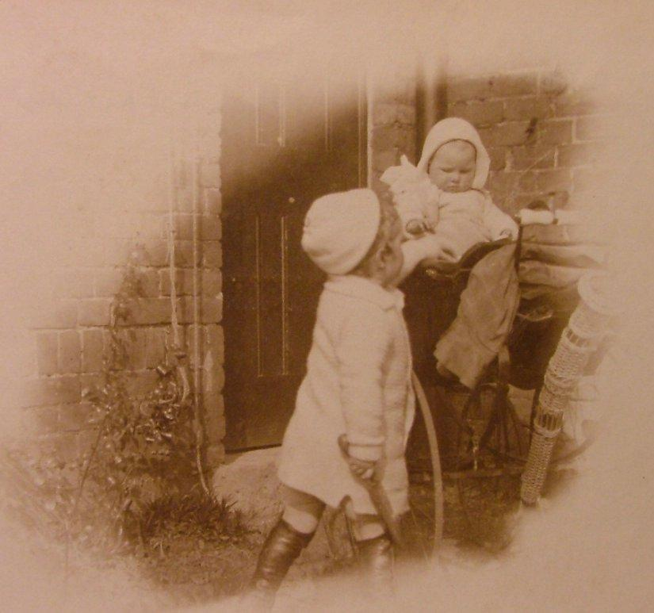
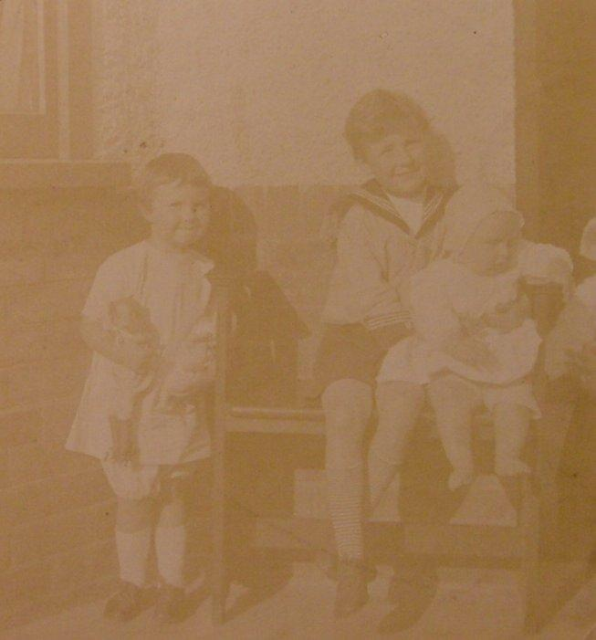
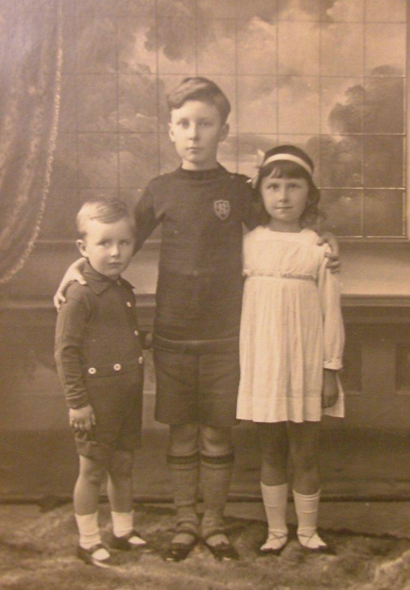
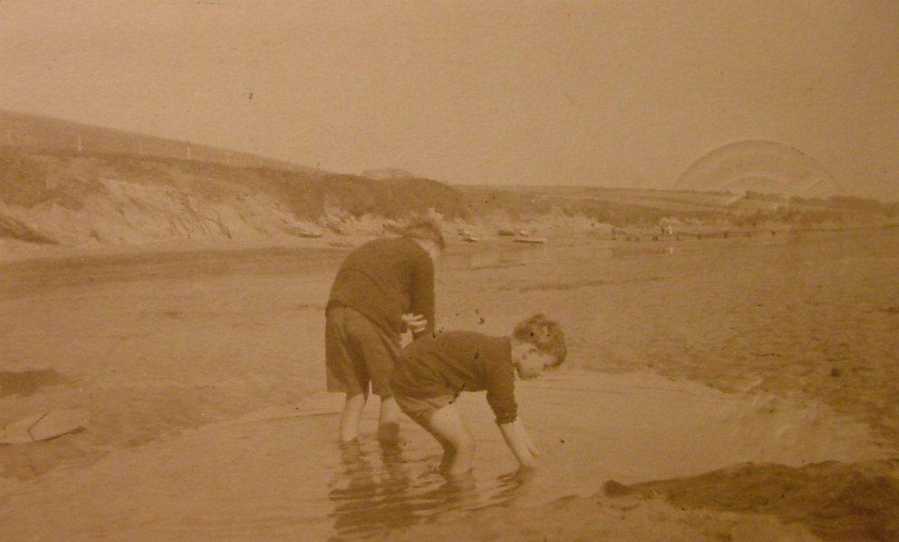
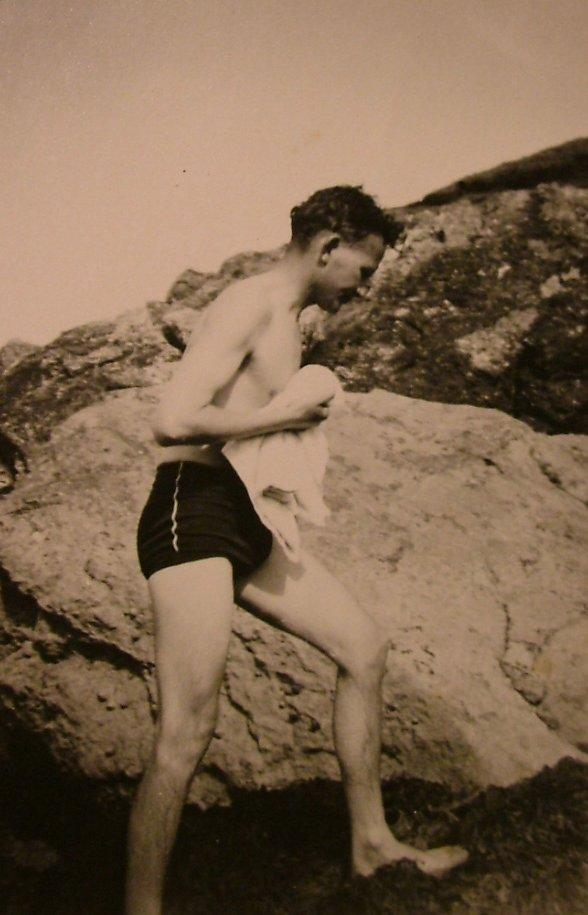
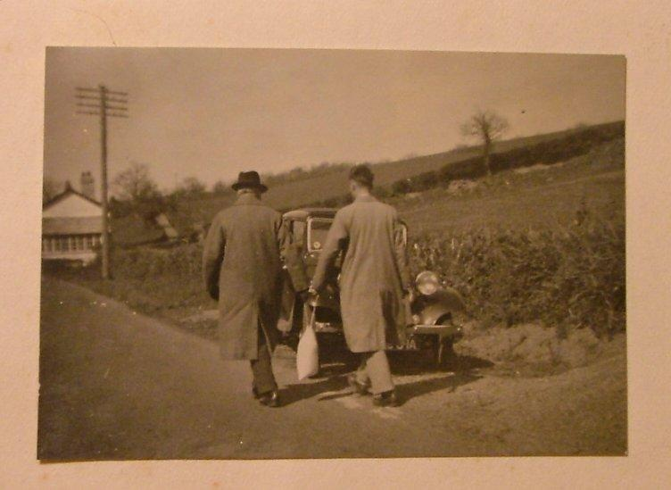
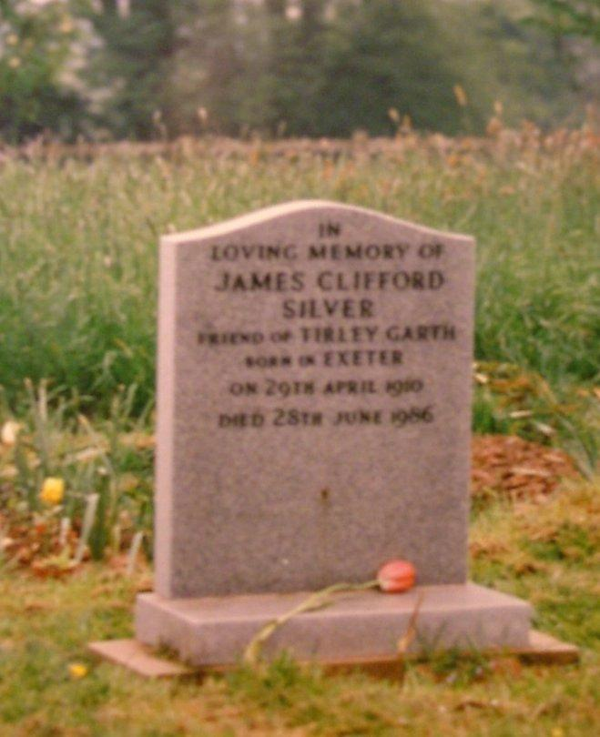

*← [Silver Family Archive](./)*

**James Clifford Silver** (20 April 1910 – 28 June 1966) was the eldest of the children of the Exeter dentist [Clifford Marking Silver](Clifford-Marking-Silver/) and [Gladys](Gladys-Silver/), born in Exeter. As a young man he joined the **Oxford Group**, later called **Moral Re-Armament**, and lived and worked at its English headquarters, **Tirley Garth**, near Tarporley in Cheshire. His brother [David](David-Silver/) visited him there from RAF Cosford in 1944, and in December 1952 James was best man at David and Anthea's wedding at St David's, Exeter. His gravestone calls him **"friend of Tirley Garth"**. After their mother died, it was James who cleared the house in Velwell Road with a bonfire; David saved what photographs he could "before James' bonfire".

**Family.** Parents: [Clifford](Clifford-Marking-Silver/) and [Gladys](Gladys-Silver/). Brothers and sisters: Lavender, Philip, [Christopher](Christopher-Silver/), [David](David-Silver/) and Rosemary.

---

## In the letters

- **1944** · [Letters from Cosford](Cosford-Letters): David visits James at Tirley Garth in January and March 1944 and sees a revue there that "really was quite good". James is ill with "colitis … the fashionable illness that Axel Munthe told his patients they had".
- **1947** · [Letters from the Isle of Man](Isle-of-Man-Letters): James gives David a purse.
- **1952** · [Letters from Bristol](Bristol-Letters): James, working at Tirley Garth and Stevenage, is to be best man at David's wedding.

---

## Photographs

*Photographs from the Old Silver photos collection saved by David Silver. Unlabelled prints identified by Tamsin and Andy Titcomb, 2026.*
