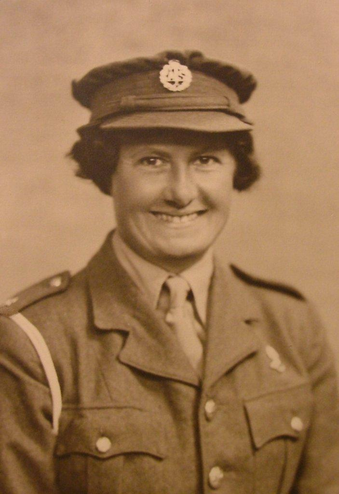
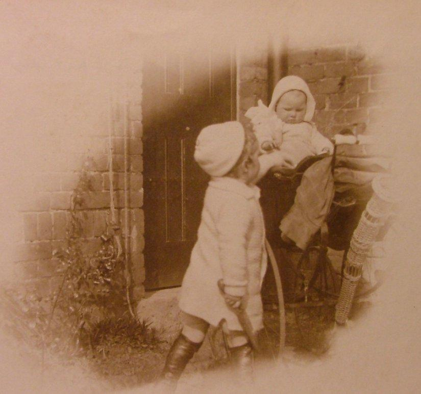
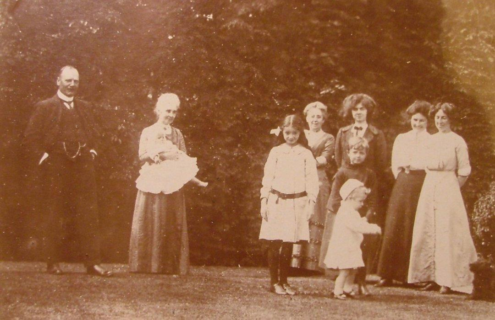
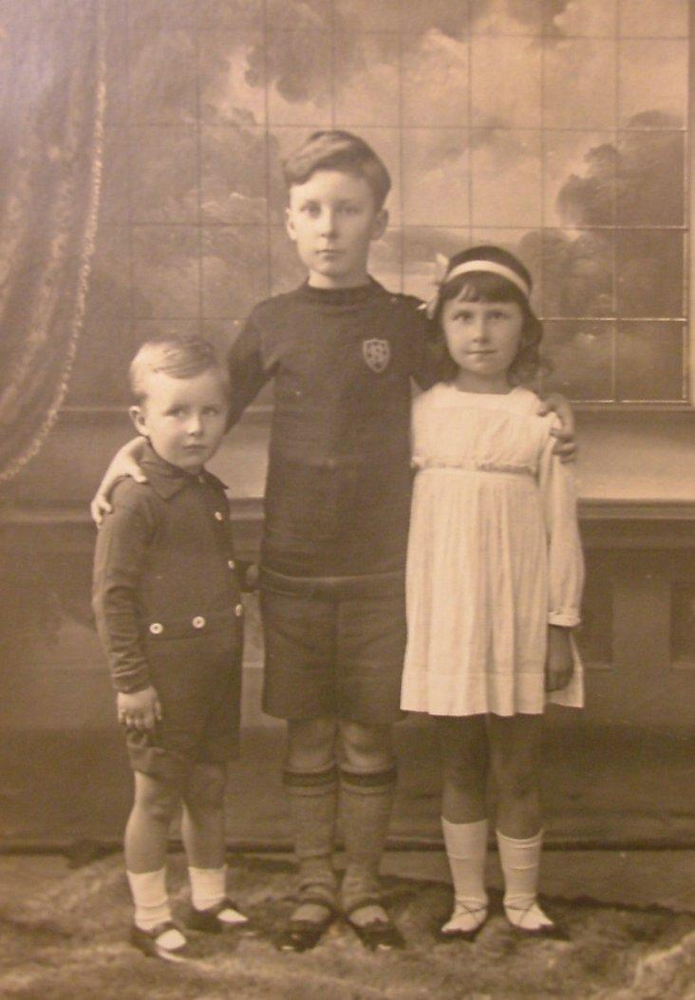
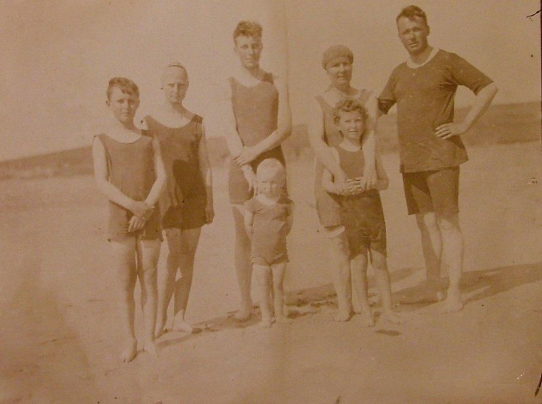
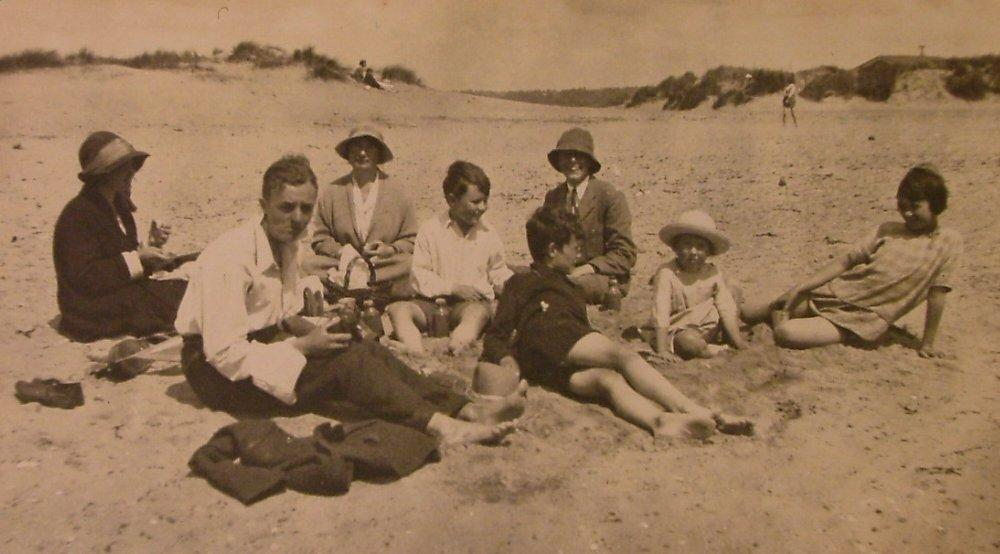

*← [Silver Family Archive](./)*

**Lavender Charlotte Silver** was the second child of the Exeter dentist [Clifford Marking Silver](Clifford-Marking-Silver/) and [Gladys](Gladys-Silver/), born about 1912, and the elder of their two daughters. In the Second World War she served in the **Auxiliary Territorial Service** (ATS), the women's branch of the Army, and her portrait in uniform survives. In May 1942 her brother [David](David-Silver/), training as a night-fighter radar operator, wrote home that "Lavender's work is the same only on the ground and without the guns", which suggests she worked on radar with an anti-aircraft battery, as many ATS women did. In later letters he asks for her new address, posts her parcels, and reports "a letter from Lavender yesterday, she seems to be pretty busy".

**Family.** Parents: [Clifford](Clifford-Marking-Silver/) and [Gladys](Gladys-Silver/). Brothers and sisters: [James](James-Clifford-Silver/), [Philip](Philip-Silver/), [Christopher](Christopher-Silver/), [David](David-Silver/) and Rosemary.

---

## In the letters

- **1942** · [The Bruton Letters](Bruton-Letters), letter 65 (9 May 1942): "Lavender's work is the same only on the ground and without the guns."
- **1944** · [Letters from Oulton](Oulton-Letters): "I had a letter from Lavender yesterday, she seems to be pretty busy."
- **1952–53** · [Letters from Bristol](Bristol-Letters): after David's wedding, "Lavender's sheets are very nice".

---

## Photographs

*Photographs from the Old Silver photos collection saved by David Silver. Unlabelled prints identified by Tamsin and Andy Titcomb, 2026.*
