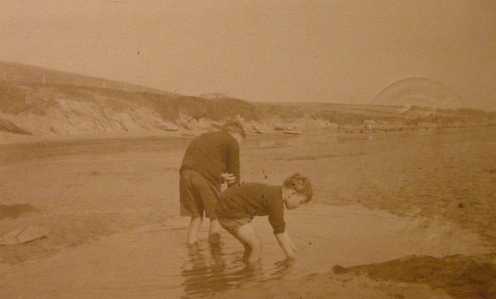
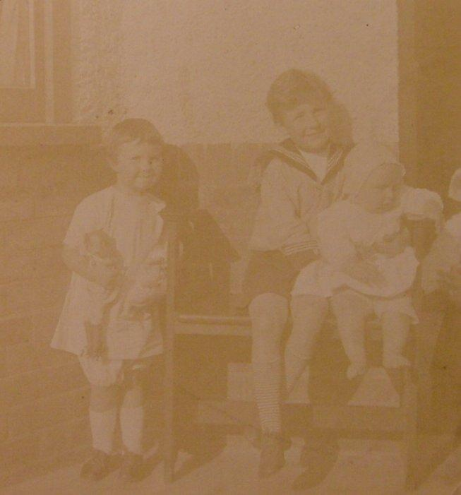
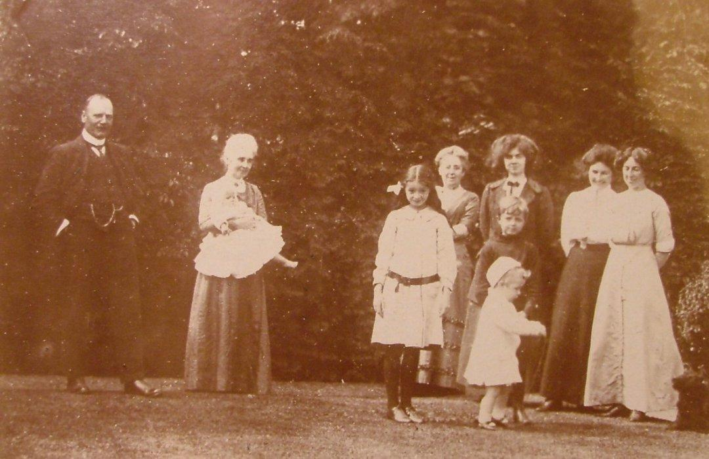
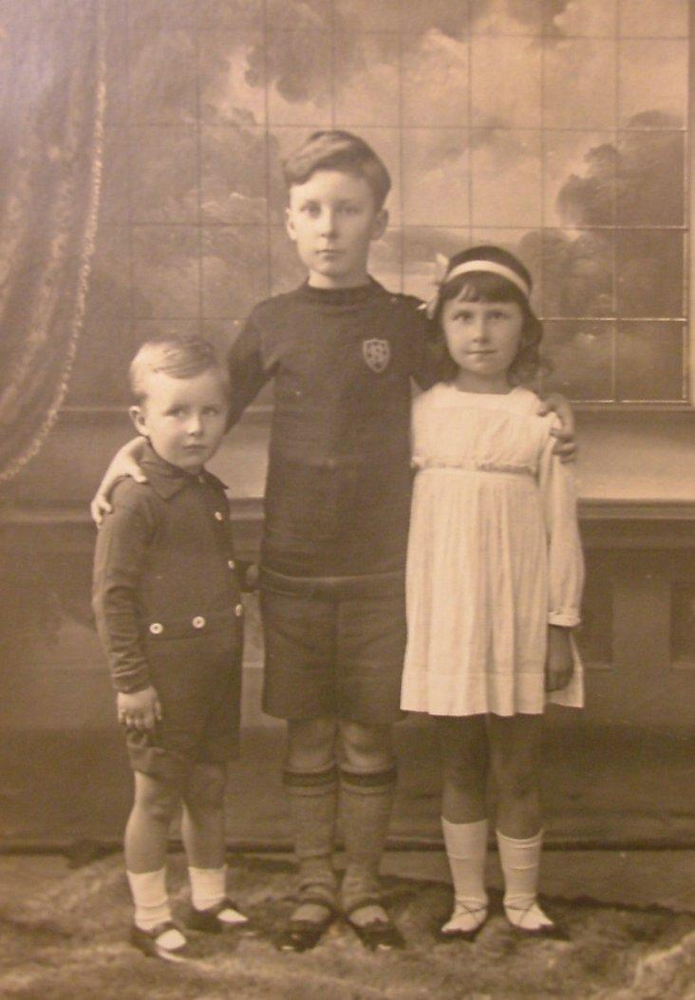
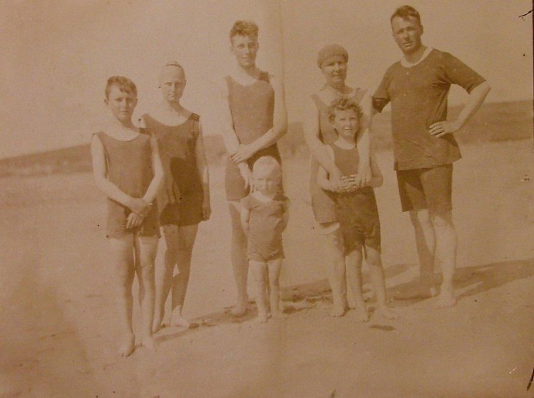

*← [Silver Family Archive](./)*

**Philip Sidney Silver** (born 1915) was the third child of the Exeter dentist [Clifford Marking Silver](Clifford-Marking-Silver/) and [Gladys](Gladys-Silver/); the family called him "Phippy" as a small boy and "Phil" later. He trained as a doctor, apparently at **Guy's Hospital** in London, from where he sent home photographs of the air-raid trenches "dug & made by students" in the first year of the war. By 1943 **Dr Philip Silver** was living in **Grimsby** and holding a clinic in **Skegness** every Thursday, so when his youngest brother [David](David-Silver/) arrived there for RAF basic training in October 1943 the two met each week. David wrote home that Philip drove him in "his Riley which I admired — after Lynette the Riley evidently is his greatest joy". Lynette was Philip's small daughter. By 1952 Philip had moved to **Bury**, Lancashire. In 1999 David wrote on the back of a photograph that he must "ask Philip (P.S. Silver, b. 1915)" about the Acott family's history.

**Family.** Parents: [Clifford](Clifford-Marking-Silver/) and [Gladys](Gladys-Silver/). Brothers and sisters: [James](James-Clifford-Silver/), [Lavender](Lavender-Silver/), [Christopher](Christopher-Silver/), [David](David-Silver/) and Rosemary.

---

## In the letters

- **1937–1942** · [The Bruton Letters](Bruton-Letters): Philip's photographs of Timmy the cat and the Guy's air-raid shelter.
- **1943–1944** · [Letters from Skegness](Skegness-Letters): weekly meetings at Philip's Thursday clinic, dinner at the George Hotel, and the Riley.
- **1944** · [Letters from Cosford](Cosford-Letters): Philip and his family.
- **1952–53** · [Letters from Bristol](Bristol-Letters): David posts Philip's book to "an address in Bury, Lancs", and Philip sends a cheque as a wedding present.

---

## Photographs

*Photographs from the Old Silver photos collection saved by David Silver. Unlabelled prints identified by Tamsin and Andy Titcomb, 2026.*
