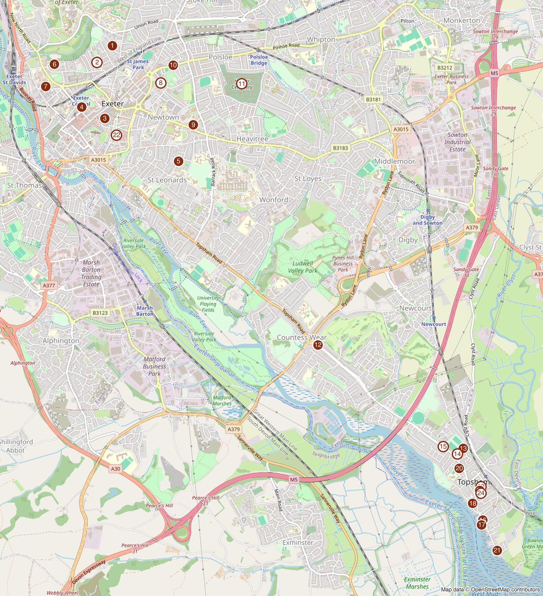
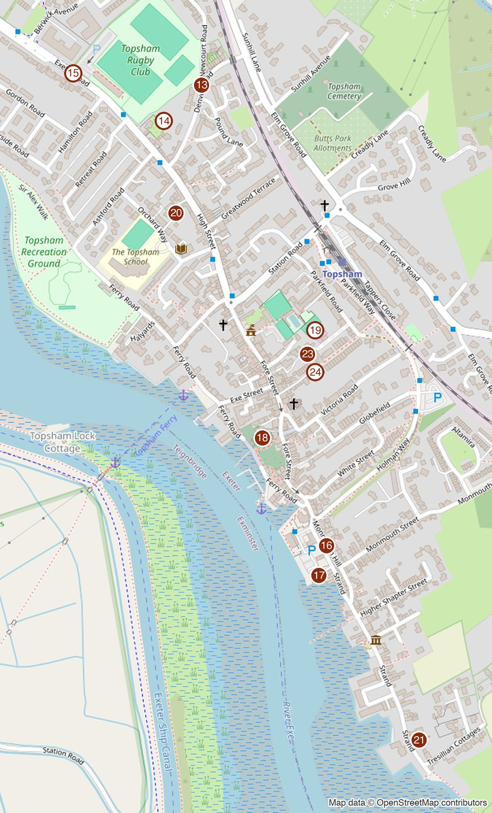

*← [Places & history](Places/) · [Silver Family Archive](./)*

Every place in Exeter and Topsham that appears in these pages, from the Acotts' Mona Lodge and the Silvers' Tresillian to Anthea Leigh's childhood homes by the Exe. Click a numbered marker for the story and the pages about it. A hollow marker means the position is approximate. The map is rebuilt whenever new places turn up in the archive.

<iframe src="https://jagosilver.github.io/silver-family-archive/static/maps/exeter-topsham.html" title="Interactive map of family places in Exeter and Topsham" style="width:100%;height:600px;border:1px solid #ccc;border-radius:6px" loading="lazy"></iframe>

*[Open the map full screen](https://jagosilver.github.io/silver-family-archive/static/maps/exeter-topsham.html)*

## The places

| # | Place | When | What happened | Pages |
| --- | --- | --- | --- | --- |
| 1 | **Tresillian, West Avenue**, Exeter | 1899–c.1950 | The Silver family home: Clifford and Gladys brought up their children here. Shot up in the Exeter Blitz, May 1942, and still standing. | [Clifford Marking Silver](Clifford-Marking-Silver/#tresillian), [David Silver](David-Silver/#tresillian-and-the-exeter-blitz) |
| 2 | **Higher Barracks *(approx.)***, Exeter | 1942 | "Part of the barracks, full of the army, about 300 yards away from our house" was destroyed in an air raid David watched as a warden in 1942. | [David's WWII tape](WWII-Interview) |
| 3 | **Bedford Circus**, Exeter | c.1906–1942 | Clifford's dental surgery stood here "until 1942". The Georgian circus was gutted in the Blitz and later demolished; Princesshay now covers the site. | [Clifford Marking Silver](Clifford-Marking-Silver/#the-dental-practice) |
| 4 | **Exeter School of Art (Royal Albert Memorial Museum building)**, Exeter | 1942–43 | David spent about two terms at the Exeter School of Art before joining the RAF. | [David Silver](David-Silver/#exeter-and-the-war) |
| 5 | **Mona Lodge, Lyndhurst Road**, Exeter (St Leonards) | c.1900–1921 | Rupert Philip Acott's house, with lions on the gateposts, and Gladys's childhood home. Muriel Acott was married from here. Still standing. | [The Acott Family](Acott-Family/#rupert-philip-acott-18531941-and-charlotte-rowell), [Gladys Silver](Gladys-Silver/) |
| 6 | **Velwell Road, St David's**, Exeter | c.1951–1960s | Clifford and Gladys's home after Tresillian. David saved the family photographs from here "when my mother died". | [Clifford Marking Silver](Clifford-Marking-Silver/), [Letters from Bristol](Bristol-Letters) |
| 7 | **St David's Church**, Exeter | 1952 | David Silver and Anthea Leigh were married in a side chapel here at the end of December 1952, with James as best man. | [Letters from Bristol](Bristol-Letters), [David Silver](David-Silver/), [Anthea Silver](Anthea-Silver/) |
| 8 | **The Belmont Nursing Home *(approx.)***, Exeter | 1925, 1928 | Anthea Leigh was born here on 30 April 1928, in "a beautiful Georgian terrace in Exeter, later destroyed in the blitz". Position approximate. | [A Topsham Childhood](A-Topsham-Childhood) |
| 9 | **Endsleigh School, Grendon Road**, Exeter | c.1937–1939 | "A girls only day school on the corner of Grendon Road", where Anthea and her sister Mary went until the daylight raids on Exeter. | [A Topsham Childhood](A-Topsham-Childhood) |
| 10 | **Alexandra Terrace, Blackboy Road**, Exeter | 1960 | Anthea wrote to David from Alexandra Terrace in July 1960, with Tamsin, Bridget and Candy at home. |  |
| 11 | **Exeter Higher Cemetery *(approx.)***, Exeter | 1921? | David believed his grandmother Charlotte Acott was "buried in Exeter Cemetery". Which cemetery isn't certain. Position approximate. |  |
| 12 | **Sundew and the garage, Countess Wear**, Countess Wear | c.1924–1930 | Tom and Edith Leigh's bungalow and garage on the Countess Wear crossroads, where Anthea was brought home as a baby. | [A Topsham Childhood](A-Topsham-Childhood) |
| 13 | **Denver House and Denver Nurseries, Denver Road**, Topsham | c.1901–1940s | Thomas Bolt Pyne's house and fruit-tree nursery, employing about thirty men: Anthea's grandparents' home, "big, comfortable and secure". | [A Topsham Childhood](A-Topsham-Childhood) |
| 14 | **Meadow Hayes *(approx.)***, Topsham | 1935–1946 | Anthea's childhood home, in the meadow opposite Denver Nurseries, until the family left in 1946. "I still dream about Meadow Hayes." | [A Topsham Childhood](A-Topsham-Childhood) |
| 15 | **Park Field, by the Exeter Road *(approx.)***, Topsham | 1934–35 | A sewer trench cut through Park Field, opposite the Pyne nurseries, turned up Romano-British pottery, coins and glass. | [Romano-British Antiquities](Denver-Excavation) |
| 16 | **"Doone", Monmouth Hill**, Topsham | c.1932–1935 | The Leighs' semi-detached house with a long front garden, where Anthea's sister Gillian was born. | [A Topsham Childhood](A-Topsham-Childhood) |
| 17 | **The Strand**, Topsham | 1930s | Anthea's father worked at Mr Seldon's garage on the Strand, and her godmother Peggy Dolling lived here. | [A Topsham Childhood](A-Topsham-Childhood) |
| 18 | **St Margaret's Church**, Topsham | 1930s–40s | "The church was the centre of the community": Anthea sang in the choir here for years. | [A Topsham Childhood](A-Topsham-Childhood) |
| 19 | **Rosapenna *(approx.)***, Topsham | 1921–1941 | Rupert Philip Acott moved to Rosapenna in Topsham after his wife died, and lived there until his death in 1941. Exact location not yet found. | [The Acott Family](Acott-Family/#rupert-philip-acott-18531941-and-charlotte-rowell) |
| 20 | **Jenin Cottage**, Topsham | ?–c.1984 | David and Anthea Silver's home in Topsham until they moved to Westleigh, Wadebridge, in about 1984. A former pigsty in the garden was Andy Titcomb's first workshop, where he made his first teapot in 1983. | [David Silver](David-Silver/), [Anthea Silver](Anthea-Silver/) |
| 21 | **Reka Dom, The Strand (Flats A and B)**, Topsham | c.1975–1990 | Andy and Tamsin Titcomb rented two flats in this old merchant's house: first Flat A, then Flat B, where Jago grew up, until the family moved to Cornwall in October 1990. | [Jago Silver](Jago-Silver/) |
| 22 | **Exeter Benefit Building Society, Southernhay *(approx.)***, Exeter | c.1950 | David photographed this Georgian terrace front, then the Exeter Benefit Building Society's office, and drew it for his architecture course. The drawing survives in the family. Probably on Southernhay; position approximate. | [David Silver](David-Silver/), [Letters from Bristol](Bristol-Letters) |
| 23 | **Topsham First School, Majorfield Road**, Topsham | 1984–1988 | Jago's first school, 1984–88, in the old Quaker meeting house on Majorfield Road (a school since 1852). His grandmother Anthea, an architecture graduate, was involved in its design in some way, and his great-grandmother Edith Leigh lived two doors along. | [Anthea Silver](Anthea-Silver/) |
| 24 | **Owl Granny's house, Majorfield Road *(approx.)***, Topsham | 1980s | Edith Leigh ("Owl Granny") lived two houses from Topsham First School. Jago walked round to her for "home lunch": steak and kidney pie, then apple pie. Which house isn't recorded; position approximate. | [A Topsham Childhood](A-Topsham-Childhood) |

*Map data © OpenStreetMap contributors. Positions are street-level only.*
